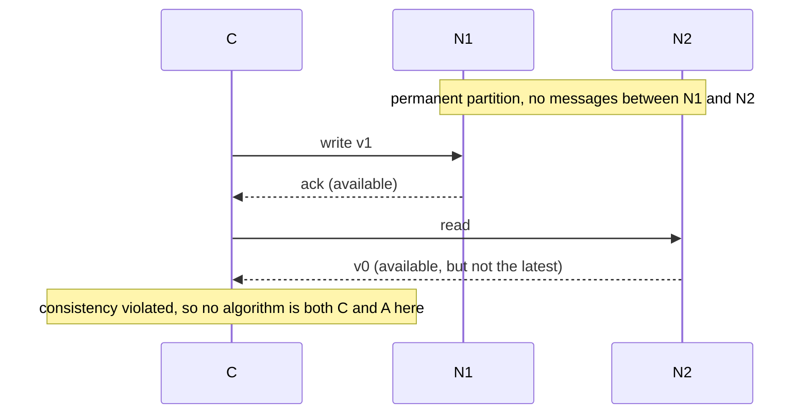

# 9. Consistency

[← 8. Replication](08-replication.md) · [Book](../README.md) · [10. Distributed consensus →](10-distributed-consensus.md)

## Summary

In databases, consistency means application-level validity. In distributed systems, where components fail and messages are delayed, reordered or lost, it has many meanings (p. 117). The chapter models a system as sequential **processes** whose **operations** have an invocation and a completion. A **history** is the real-time sequence of those events, and a **consistency model** is a predicate that sorts histories into valid and invalid (pp. 117–118). Stronger models (subsets) give a better developer experience; weaker models (supersets) give better availability and latency (pp. 119–121).

The chapter then covers the two ends of the spectrum:

- **Linearizability** is a *recency* guarantee: every operation appears to take effect at a single point between its invocation and completion, so a replicated system behaves like a single copy. It's defined per object type, illustrated with queues, stacks and an increment-only counter (pp. 121–124).
- **Eventual consistency** is a *convergence* guarantee, illustrated with Amazon's shopping cart. It comes in basic and strong variants and is implemented by application-specific or algorithmic (CRDT) reconciliation (pp. 124–126).

The chapter ends with **CAP**: Brewer's conjecture versus Gilbert and Lynch's theorem, their proof, and the critique that the theorem is precise but impractical (pp. 126–129).

## Key takeaways

- **An operation is an invocation–completion pair**, and processes are strictly sequential. A **history** orders these events in real time (pp. 117–118).
- **A consistency model is a set of histories.** A system is consistent *with respect to a model* if all its possible histories are valid. Systems don't "violate consistency"; they violate a specific model (pp. 118–119).
- **Stronger = fewer valid histories.** Stronger models need more coordination, which costs availability and latency but improves the developer experience (pp. 119–121).
- **Linearizability:** a sequential history with the same results exists, *and* it respects the real-time order of non-overlapping operations. It's a real-time guarantee about single operations on single objects, defined per object type (pp. 121–123).
- **A linearizable history is a fact; a linearizable system is a guarantee** that every possible history is linearizable (p. 123).
- **Eventual consistency:** basic = eventual delivery + weak convergence (once updates stop); strong = eventual delivery + strong convergence (the same updates give the same state) (p. 125).
- **CRDTs:** operation-based (commutative) CRDTs need no lost operations, effectively-once application and a commutative apply. State-based (convergent) CRDTs need an associative, commutative, idempotent merge (p. 126).
- **CAP isn't "pick two".** Partitions are inevitable, so the real choice is between consistency and availability *during* a partition (p. 127). The conjecture is intuitive but unproven; the theorem is proven but narrow (p. 129).

## Section outline

*From the book’s own table of contents (PDF bookmarks); printed page numbers.*

- 9.1 Consistency models — p. 117
  - 9.1.1 Common consistency models — p. 119
  - 9.1.2 Virtues and limitations — p. 119
- 9.2 Linearizability — p. 121
  - 9.2.1 Queue and stack — p. 122
  - 9.2.2 Formal definition of linearizability — p. 123
- 9.3 Eventual consistency — p. 124
  - 9.3.1 The shopping cart — p. 124
  - 9.3.2 Variants of eventual consistency — p. 125
  - 9.3.3 Implementation — p. 125
- 9.4 Consistency, availability, and partition tolerance — p. 126
  - 9.4.1 History — p. 126
  - 9.4.2 Conjecture vs. theorem — p. 127
  - 9.4.3 CAP theorem — p. 128

## Notes

### 9.1 Consistency models

The chapter reasons about a system as concurrent **processes** operating on **objects** (pp. 117–118):

- A process is a sequence of operations on objects.
- An object's *type* defines its possible values and operations.
- An operation isn't instantaneous: **Operation = Invocation • Completion**.
- Processes are **strictly sequential**: each invokes one operation and waits for its response before the next (Figure 9.1).

A **history** is the sequence of invocation and completion events ordered by real time, for example H = [I•A.1, I•B.1, C•A.1, I•A.2, C•B.1, C•A.2] (p. 118). A **consistency model** is a set of histories, a predicate that classifies a history as good (valid) or bad (invalid) (Figure 9.2). A system is consistent *with respect to a model* if every possible history of the system is valid under it (p. 118).

**Aha! moment:** "violating consistency" is a misconception. A system can only fail to meet the guarantees of a *specific* model (pp. 118–119).

#### 9.1.1 Common consistency models (p. 119)

Correctness is application-specific, so you could define your own model. In practice, a family of well-defined models has emerged. Figure 9.3 reproduces Jepsen's map:

| Availability class (from the Jepsen map) | Examples |
|---|---|
| **Unavailable**: some nodes must pause during some partitions | Strict serializable, serializable, linearizable, sequential, repeatable read, snapshot isolation |
| **Sticky available**: available on nonfaulty nodes if each client keeps talking to the same node | Causal, PRAM, read your writes |
| **Total available**: available on nonfaulty nodes even during a partition | Read committed, read uncommitted, monotonic reads, monotonic writes, writes follow reads, monotonic atomic view |

#### 9.1.2 Virtues and limitations (pp. 119–121)

Two models may be disjoint, overlapping, or one a subset of the other (Figure 9.4). **Subsets, with fewer valid histories, are stronger; supersets are weaker** (p. 119). Products expose the spectrum. Azure Cosmos DB, for example, offers Strong, Bounded staleness, Session, Consistent prefix and Eventual consistency, with availability, latency and throughput improving toward Eventual (Figure 9.5) (p. 120).

| Direction | Gain | Lose |
|---|---|---|
| **Stronger** | **Developer experience**: more of distribution's effects are hidden | Availability and latency, because of more coordination |
| **Weaker** | Availability, latency | Developer experience: more of distribution's effects are exposed |

(Figure 9.6) (pp. 120–121)

A good developer experience leaves no room for unwanted surprises (p. 121). In Figure 9.7, process A writes x = 10, gets OK, then reads x and gets 0. Whether that's correct depends on the model:

- If reads must return the *most recent* value, it's incorrect. That expectation is **linearizability**.
- If reads may return *any previous* value, it's correct. That expectation is **eventual consistency**.

### 9.2 Linearizability

**Linearizability**, also called **atomic consistency**, is one of the strongest models. It's a **recency guarantee**: once an operation completes, every later operation sees its effects (p. 121). It was introduced for shared objects on multiprocessors, and applies equally to replicated distributed systems. It makes a replicated system behave like a non-replicated one, giving **replication transparency** (p. 121). It is a *real-time* guarantee about *single operations* on *single objects*, defined *per object type* (pp. 121–122).

#### 9.2.1 Queue and stack (p. 122)

Correct behavior is first defined for a single process and a single object (Tables 9.1–9.2). Linearizability extends that to many processes and many copies:

| Trace | Queue (FIFO) | Stack (FILO) |
|---|---|---|
| insert(a), insert(b), remove → a, remove → b | ✓ valid | ✗ invalid |
| insert(a), insert(b), remove → b, remove → a | ✗ invalid | ✓ valid |

#### 9.2.2 Formal definition of linearizability (pp. 123–124)

A history is **sequential** if every invocation is immediately followed by its completion, and **concurrent** otherwise, when operations interleave (Table 9.3). A history H is **linearizable** if (p. 123):

1. **Sequential equivalence:** there's a sequential history H′ that gives the same results as H.
2. **Real-time ordering:** H′ respects the real-time order of non-concurrent operations in H. An operation invoked after another one completed must see its effects.

Figure 9.8 shows a non-linearizable history (pp. 123–124):

- A replicated increment-only counter starts at 0.
- Process B's increment completes, and *then* process A reads 1 from a lagging replica.
- Linearizability would require 2, because A's read follows B's increment. The history exposes the replicas and their lag.

**Aha! moment:** a *linearizable history* is a fact (an equivalent sequential history exists). A *linearizable system* is a guarantee (every possible history is linearizable) (p. 123). Implementing it is the subject of Chapter 10, on consensus (p. 124).

> **Try it:** [Is this history linearizable?](../widgets/09-linearizability.html) — drag operations of three processes on a register along a timeline, and the checker searches for a sequential order that gives the same results and respects real time, or explains which pair of operations makes it impossible.

### 9.3 Eventual consistency

**Eventual consistency** is one of the weakest models. It's a **convergence guarantee**: eventually, all nodes are in the same state. Werner Vogels of AWS popularized the term for Amazon's DynamoDB (p. 124).

#### 9.3.1 The shopping cart (pp. 124–125)

In Figure 9.9, two replicas both hold {A} when a partition separates them:

- Replica 1: remove(A), then add(B), giving {B}.
- Replica 2: add(C), giving {A, C}.
- After the partition heals, both become **{A, B, C}**.

The conflict has to be resolved by the engineers. Amazon's priority is to keep added items over removed ones, so no added item vanishes, but removed items occasionally **resurrect**. The trade-off is availability against a surprise-free developer and user experience (p. 125).

> **Try it:** [The eventually consistent shopping cart](../widgets/09-shopping-cart.html) — partition two cart replicas, add and remove items on each side, heal the partition, and compare reconciliation rules: Amazon's "adds win" (Figure 9.9), last write wins, and a grow-only set.

#### 9.3.2 Variants of eventual consistency (p. 125)

| Variant | Guarantees |
|---|---|
| **Basic** | **Eventual delivery**: an update to one nonfaulty replica eventually reaches every nonfaulty replica. **Weak convergence**: once updates stop, all replicas eventually converge. Says nothing about reads before convergence or about continuous updates |
| **Strong** | **Eventual delivery** plus **strong convergence**: any two replicas that have received the same set of updates are in the same state |

#### 9.3.3 Implementation (pp. 125–126)

Any replica can be modified at any time, even while disconnected, so conflicts need reconciliation:

| Approach | How |
|---|---|
| **Application-specific** | The application decides; in the cart, additions win over removals (p. 125) |
| **Algorithmic: CRDTs** | Data structures that allow independent concurrent updates on replicas while guaranteeing convergence (p. 126) |

| CRDT kind | Replicates | Convergence requires (p. 126) |
|---|---|---|
| **Operation-based** (commutative) | Individual operations | No lost operations, each applied effectively once, and a commutative apply function |
| **State-based** (convergent) | The entire state | An associative, commutative, idempotent merge |

Table 9.4 shows the **grow-only set** both ways: apply `add x` with set := set ∪ {x}, or merge set := set ∪ set′. Riak, among others, uses CRDT principles (p. 126).

### 9.4 Consistency, availability, and partition tolerance

CAP is possibly the best-known and most misunderstood principle in distributed systems (p. 126).

#### 9.4.1 History (pp. 126–127)

| | Who and when | Status |
|---|---|---|
| **CAP conjecture** | Eric Brewer, PODC 2000 keynote "Towards Robust Distributed Systems" | Presented as a theorem, but with no proof: an attempt to *formulate* the C–A conflict |
| **CAP theorem** | Seth Gilbert and Nancy Lynch, 2002 | A formal proof: an attempt to *formalize* it |

**Aha! moment:** "pick two out of three" implies partitions are optional, but they're inevitable. So tolerating partitions is non-negotiable, and when one occurs you choose consistency *or* availability. CAP divides the world into **CP and AP** systems (p. 127).

#### 9.4.2 Conjecture vs. theorem (pp. 127–128)

Both treat consistency as a safety property and availability as a liveness property (p. 127):

- **Consistency:** every read receives either a success that reflects the most recent write, or a failure.
- **Availability:** every read eventually receives a success, which need not reflect the most recent write.
- **Partition:** the network splits into segments, and messages between segments are lost.

| | Conjecture | Theorem |
|---|---|---|
| **Consistency** | Single-copy serializability | Linearizability of a read/write register |
| **Availability** | *Some* node responds *timely* | *Any* node responds *eventually* |
| **Partitioning** | Temporary | Permanent |

(Table 9.5) (p. 128)

#### 9.4.3 CAP theorem (pp. 128–129)

The model: nodes C, N1 and N2, with no clocks, communicating over an asynchronous network. N1 and N2 both start with v0, and a **permanent partition** separates N1 from N2, while C can reach both (Figure 9.10) (p. 128). The proof is by contradiction:

*The vault's drawing of the proof on pp. 128–129.* With a permanent partition no information crosses at all, so even the weakest consistency is impossible. Kleppmann's "A Critique of the CAP Theorem" formalizes CAP more carefully (p. 129).

**Critique** (p. 129):

- Brewer's version is intuitive and practical, but not a theorem. Gilbert and Lynch's is a theorem, but neither intuitive nor practical.
- CAP taught the community to think about inherent trade-offs, but it's also misused to shut down conversations where it doesn't apply.
- Kleppmann's blog post "Please stop calling databases CP or AP" asks to retire CAP in favor of more precise terminology.

## Trade-offs at a glance

| Model | Guarantee | Coordination | Available during partitions? |
|---|---|---|---|
| Linearizable | Recency: a single copy in real time | High (consensus, Chapter 10) | No: some nodes must pause |
| Sequential | A single order, but not real time | High | No |
| Causal | Causally related operations in order | Medium | Sticky available |
| Read your writes, monotonic reads | Per-client guarantees | Low | Sticky or total available |
| Eventual (basic) | Convergence after updates stop | None at write time | Yes |
| Strong eventual (CRDTs) | Same updates ⇒ same state | None at write time | Yes, but the data type must have a convergent merge |

## Beyond the book

- **Checking linearizability is expensive.** Deciding whether a history is linearizable is NP-complete in general (Gibbons and Korach, 1997). Tools such as Jepsen's Knossos and Porcupine search the space of orderings with pruning. The [widget](../widgets/09-linearizability.html) brute-forces a handful of operations, which is the same idea at toy scale.
- **PACELC.** Abadi's extension of CAP says: if there is a partition (P), choose availability (A) or consistency (C); else (E), choose latency (L) or consistency (C). That's closer to the book's Figure 9.6 trade-off, which applies even without partitions.
- **Linearizability vs. serializability.** Serializability (Chapter 5) concerns multi-object transactions with *some* serial order. Linearizability concerns single objects in *real-time* order. *Strict serializability* is both. [DDIA Ch. 10](../../designing-data-intensive-applications/chapters/10-consistency-and-consensus.md) draws the same distinction.

## Connections

- **Related chapters:** [5. Transactions](05-transactions.md) (serializability, consistency as a predicate on histories), [8. Replication](08-replication.md) (replication lag and transparency), [10. Distributed consensus](10-distributed-consensus.md) (how to implement linearizability), [3. Failure tolerance](03-failure-tolerance.md) (masking failure tolerance and CAP).

## Check yourself

*Questions and answers are the vault's, written from the notes above; answers cite the book's pages.*

1. **What is a consistency model, formally?**

   *Answer:* A set of histories, or equivalently a predicate on histories that classifies each as valid or invalid. A system is consistent with respect to the model if all its possible histories are valid (p. 118).

2. **What does it mean for model A to be stronger than model B?**

   *Answer:* A's valid histories are a subset of B's: it allows fewer histories (p. 119).

3. **What are the two conditions for a history to be linearizable?**

   *Answer:* Sequential equivalence (some sequential history gives the same results) and real-time ordering (that history respects the order of non-overlapping operations) (p. 123).

4. **In Figure 9.8, why isn't the history linearizable?**

   *Answer:* A's read starts after B's increment completed, so it must return 2. It returned 1 from a lagging replica (pp. 123–124).

5. **What distinguishes strong eventual consistency from basic eventual consistency?**
   - [ ] Strong eventual consistency is linearizable
   - [x] Any two replicas that received the same set of updates are in the same state
   - [ ] Updates are delivered immediately

   *Answer:* Strong convergence replaces weak convergence (p. 125).

6. **What must the merge function of a state-based CRDT be?**

   *Answer:* Associative, commutative and idempotent (p. 126).

7. **Why is "pick two out of three" a misreading of CAP?**

   *Answer:* It treats partitions as optional. They're inevitable, so the real choice is between consistency and availability when a partition happens (p. 127).

8. **How do the conjecture and the theorem define availability?**

   *Answer:* The conjecture: some node responds in a timely way. The theorem: any node responds eventually (p. 128).
