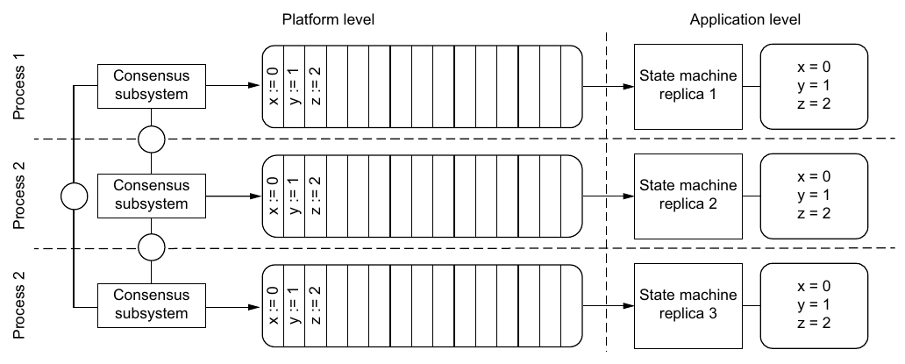
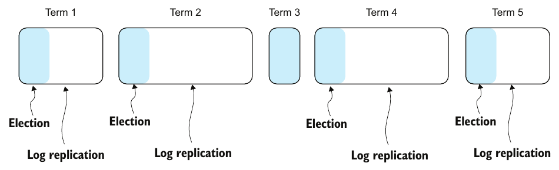

# 10. Distributed consensus

[← 9. Consistency](09-consistency.md) · [Book](../README.md) · [11. Durable executions →](11-durable-executions.md)

## Summary

**Distributed consensus** lets a group of redundant processes advance in lockstep and act as one, so some can compensate for the failure of others. Failing to agree is often catastrophic: did the transaction commit, which operation came first, who holds the lock (p. 131)? Consensus is trivial without failures and notoriously hard with them. Consensus algorithms *guarantee* safety and *aim* for liveness, which FLP shows can't be guaranteed in an asynchronous system without clocks (p. 132).

The chapter specifies consensus as validity, integrity and agreement (safety) plus termination (liveness) (pp. 132–133). It explains why consensus matters: **state machine replication** turns a process into a fault-tolerant group (pp. 133–134). It tells the irony of its origin: Lamport set out to prove consensus impossible and produced Paxos, while Viewstamped Replication arguably came first (pp. 134–135). It explains how algorithms combine a **leader** with **quorums** (N = 2f + 1) (pp. 135–136). It then describes **Raft** in detail: the log and commit index, terms as fencing tokens, leader election, log replication, and the up-to-date-log rule behind **state machine safety** (pp. 136–141). It ends with three Raft puzzles (pp. 141–144).

## Key takeaways

- **Consensus = safety (validity, integrity, agreement) + liveness (termination).** Agreement and integrity capture the intuition: everyone decides the same value and nobody goes back on their word (pp. 132–133).
- **FLP:** in an asynchronous system without clocks, consensus can't be guaranteed even if only one node can fail. The result is about *liveness*, and consensus is possible in more constrained models, such as asynchronous systems with clocks (p. 132).
- **State machine replication:** identical deterministic processes that start in the same state and get the same inputs in the same order end in the same state. Lockstep reduces to **consensus on the log** (pp. 133–134).
- **Quorums:** Q > N/2, so any two quorums intersect, which prevents split brain. Tolerating f failures needs N = 2f + 1 (p. 136).
- **Leader + quorum:** a leader, elected by a quorum, proposes values and commits once a quorum acknowledges them. Multi-Paxos, Raft and Viewstamped Replication all work this way (p. 136).
- **Terms are a logical clock and a fencing token.** Raft doesn't prevent two nodes from *believing* they lead; it prevents more than one from *acting* as leader, because messages with lower terms are rejected (pp. 138–139).
- **State machine safety:** no two processes ever apply different entries at the same index. Raft ensures it by electing only candidates whose log is at least as up to date (higher last term, or the same term and longer) (p. 141).
- **Puzzle 3:** an uncommitted entry acknowledged by a follower must *not* be lost. That follower can't know whether the leader committed it before crashing (pp. 142–144).

## Section outline

*From the book’s own table of contents (PDF bookmarks); printed page numbers.*

- 10.1 The challenge of reaching agreement — p. 132
- 10.2 System model — p. 132
- 10.3 State machine replication — p. 133
- 10.4 The origin—and irony—of consensus — p. 134
- 10.5 Implementing consensus — p. 135
  - 10.5.1 Leader-based consensus — p. 135
  - 10.5.2 Quorum-based consensus — p. 136
  - 10.5.3 Combining leader and quorum — p. 136
- 10.6 Raft — p. 136
  - 10.6.1 The log — p. 137
  - 10.6.2 Terms — p. 138
  - 10.6.3 Leader Election protocol — p. 139
  - 10.6.4 Log Replication protocol — p. 140
  - 10.6.5 State machine safety — p. 141
- 10.7 Raft puzzles — p. 141
  - 10.7.1 Puzzle 1 — p. 141
  - 10.7.2 Puzzle 2 — p. 142
  - 10.7.3 Puzzle 3 — p. 142

## Notes

### 10.1 The challenge of reaching agreement

Consensus asks concurrent **processes** that communicate over a network to agree on a **single value** (p. 132). It's trivial when components never fail and the network delivers exactly once and in order. It's hard when components fail and the network reorders, delays, loses or duplicates messages (p. 132).

Atomic commitment was a consensus problem: 2PC's coordinator failure could block the protocol, keeping safety but sacrificing liveness (p. 132).

> **Vault note:** the book's text refers to atomic commitment as Chapter 8 (p. 132); it is covered in [Chapter 6](06-distributed-transactions.md).

Consensus algorithms guarantee safety and aim for (without guaranteeing) liveness: no *single* component failure can halt the system (p. 132).

**Aha! moment, the impossibility theorem** (p. 132): Fischer, Lynch and Paterson showed that in an asynchronous system without clocks, consensus can't be guaranteed in all circumstances, even with a single faulty node. The theorem is about liveness. Consensus is possible in more constrained models, for example asynchronous systems *with* clocks.

### 10.2 System model

A system is a set of **Processes** and a set of **Values** (p. 132):

- A process may fail by **crashing** (it simply halts).
- A process may **Propose(p, v)** and **Decide(p, v)**.

| Property | Kind | Formal statement (p. 133) | In words |
|---|---|---|---|
| **Validity** | Safety | Decide(p, v) ⇒ ∃ q: Propose(q, v) | Only proposed values are decided |
| **Integrity** | Safety | Decide(p, v) ∧ Decide(p, v′) ⇒ v = v′ | A decision is permanent |
| **Agreement** | Safety | Decide(p, v) ∧ Decide(q, v′) ⇒ v = v′ | No two correct processes decide differently |
| **Termination** | Liveness | ∀ alive p, ∃ v: ◇□ Decide(p, v) | Every nonfailed process eventually decides |

### 10.3 State machine replication

Consensus is the foundation of **state machine replication**, which mechanically turns a process into a fault-tolerant group. It makes physical components behave like one logical component that survives the loss of one of them (Figure 10.1) (p. 133). The principle: identical deterministic processes, the same start state, the same inputs in the same order, give the same outputs and the same state. So **lockstep reduces to consensus on the log** (pp. 133–134).

*Figure 10.2 (p. 134): a replicated key–value store. The dashed line separates the platform level (consensus on the log) from the application level (applying it), and all three replicas reach the same state.*

### 10.4 The origin—and irony—of consensus

| Algorithm | Story (pp. 134–135) |
|---|---|
| **Paxos** (Lamport, 1989) | Lamport, the 2013 Turing Award winner, set out to prove fault-tolerant consensus *impossible* and instead devised what is often considered the first fault-tolerant consensus algorithm. It treats consensus as a **single decision**: a set of write-once registers (the replicas) all get the same value |
| **Multi-Paxos** | Extends Paxos to a **series** of decisions, which makes it suitable for state machine replication |
| **Viewstamped Replication** (Oki and Liskov, 1988) | Less famous and never uses the word *consensus*, but solves the same problem, so it can be regarded as the first published consensus algorithm |

### 10.5 Implementing consensus

Multi-Paxos, Raft and Viewstamped Replication combine a **leader** with a **quorum** (p. 135).

| Approach | Works when… | Breaks when… (pp. 135–136) |
|---|---|---|
| **Leader only** (a *Benevolent Dictator for Life*, who decides everything and broadcasts it) | Nothing fails and messages are reliable | The BDFL fails (no decisions at all), or a decision message is lost (inconsistency) |
| **Quorum** (a decision counts once a majority acknowledges it) | A majority is up | — |
| **Leader elected by a quorum, which commits after a quorum acknowledges** | Combines decisiveness with reliability | — |

#### 10.5.2 Quorum-based consensus (p. 136)

- A **quorum** is a subset of processes with |Q| > N/2, so **any two quorums intersect** in at least one process.
- To tolerate f failures you need f + 1 nonfailed processes, so **N = 2f + 1**.
- The intersection prevents **split brain**: at least one node knows about the decisions of both quorums and acts as a single point of coordination.

For {p1, p2, p3} (Table 10.2), the quorums are {p1, p2, p3}, {p1, p2}, {p1, p3} and {p2, p3}. The singletons {p3}, {p2} and {p1} are not quorums.

### 10.6 Raft

Raft manages replicated logs, the basis of state machine replication. A **leader** decides the *order* of entries, and a **quorum** decides their *inclusion*, or commitment (pp. 136–137). Raft is designed for understandability but remains complex. The book follows the original paper, and variants may behave differently (p. 137).

#### 10.6.1 The log (pp. 137–138)

- Two logs are **consistent** if one is a subsequence of the other *up to the commit index*: the highest index known to be replicated on a quorum, and therefore committed.
- Log consistency is a prerequisite for **state machine safety**: committed entries are never lost and may be applied to the application's state machine. Entries past the commit index *could* be lost (Figure 10.3).
- Raft uses the logs themselves to guarantee this: in an election, only the candidates with the most up-to-date logs are eligible.

**Aha! moment:** Raft has two layers. The **platform level** runs election, replication and commitment, then hands each committed entry to the **application level**, which applies it to its own state machine (pp. 137–138).

#### 10.6.2 Terms (pp. 138–139)

Time is divided into monotonically increasing **terms**, a logical clock. Each term has an election phase (the *Request Vote* protocol) and a log-replication phase (the *Append Entries* protocol) (Figure 10.4). Per term, Raft elects a leader and delegates the log to it. The leader accepts entries, replicates them and decides when they may be applied (p. 138).

*Figure 10.4 (p. 138): a term with a failed election (term 3, a split vote) has no leader and so no log replication.*

**Aha! moment, terms as fencing tokens** (pp. 138–139): Raft does *not* guarantee that only one node *believes* it's the leader. It guarantees that only one node can *act* as the leader. A stale leader has a lower term, and nodes reject messages with a term lower than their own.

#### 10.6.3 Leader Election protocol (pp. 139–140)

*Figure 10.5 (p. 139): every transition is guarded by the term — moving up increments it, and seeing a higher one demotes the node.*

- **Follower:** listens to the leader. Its election timer has a *random* timeout and resets on every message. On expiry, it suspects the leader has failed.
- **Candidate:** increments its term, votes for itself and sends `RequestVote` to every other node. There are three outcomes: a **quorum vote** (it becomes leader), a **split vote** (a new election) or **demotion** (it learns of a new term and leader).
- **Leader:** steps down to follower when it learns of a newer term and leader.

#### 10.6.4 Log Replication protocol (p. 140)

1. **Accept:** the leader accepts an entry from a client.
2. **Append:** it appends the entry to its own log.
3. **Propagate:** it sends `AppendEntries` to the other nodes.
4. **Commit:** followers append and acknowledge. Once a quorum, *including the leader*, has acknowledged, the leader advances the **commit index** (Figure 10.6).

*Figure 10.6 (p. 140): the dashed line marks the moment of commit — one follower's ack plus the leader's own copy make a quorum of three, so the slow follower is not waited for.*

#### 10.6.5 State machine safety (p. 141)

If a process has applied the entry at index i, no process will ever apply a *different* entry at index i. Raft enforces this by electing only a candidate with the most **up-to-date** log:

| Compare the last entries' … | More up to date |
|---|---|
| Terms differ | The log whose last entry has the **later term** |
| Terms equal | The **longer** log |

So if a quorum holds an entry, no candidate without it can win, because the voting quorum intersects the quorum that holds it. A committed entry is therefore present in every future leader's log (p. 141).

### 10.7 Raft puzzles

Each puzzle has a three-node cluster in term 3 (p. 141). The author prefers thinking in systems: many behaviors are *implicit consequences* of an algorithm interacting with the system, which is the point of Puzzle 3 (p. 141).

| Puzzle | Situation | Question | Answer (pp. 141–144) |
|---|---|---|---|
| **1** (Figure 10.7) | Logs of 8, 9 and 7 entries | Who leads term 3? | **Node 2**: the leader accepts and appends client requests first, so its log is the most advanced |
| **2** (Figure 10.8) | Leader node 2 appended request 9 but didn't propagate it | Can request 9 be lost? | **Yes.** If node 2 loses leadership, the term-4 leader never heard of it. Safety isn't violated, because it wasn't committed |
| **3** (Figure 10.9) | Node 2 propagated request 9 to node 1, which acknowledged; node 2 didn't get the acknowledgment and crashes | Can request 9 be lost? | **No.** Node 1 can't know whether node 2 committed and answered the client before crashing, so it must assume 9 is committed. Only node 1 has the most up-to-date log, so only it can be elected, and it replicates 9 to node 3 and commits it (Figure 10.10) |

*Figure 10.10 (p. 144): whether node 2 crashed before or after advancing its commit index, node 1's log is the most up to date — so the next leader keeps entry 9 either way.*

> **Try it:** [Raft's election restriction and the three puzzles](../widgets/10-raft-puzzles.html) — load the book's three puzzles (or build your own logs), see which nodes are eligible under the up-to-date rule and which quorums can elect them, crash the leader, and check whether request 9 survives.

## Trade-offs at a glance

| Choice | Buys | Costs |
|---|---|---|
| Single leader (BDFL) | Simple; decisions are totally ordered | No progress when it fails; lost decisions break consistency |
| Quorum of 2f + 1 | Tolerates f crashes; quorums intersect | A majority round trip per decision; no progress without a majority |
| Leader + quorum (Raft, Multi-Paxos, VR) | Ordering by the leader, safety by quorums | Leader elections stall progress; random timeouts are a liveness heuristic (FLP) |
| Larger cluster | Tolerates more failures | Bigger quorums, so slower commits |
| Electing only up-to-date logs | Committed entries are never lost | Some nodes can't be elected; uncommitted entries may still be kept or lost |

## Beyond the book

- **Why random election timeouts?** If every follower timed out at once, each would vote for itself and split the vote every term. Randomizing the timeout, which the Raft paper suggests drawing from 150–300 ms, usually lets one candidate start first and win. It's a practical answer to FLP: liveness depends on timing, safety never does. The [election-timeout lab](../lab/10-raft-election-timeouts/README.md) measures how often split votes happen as the timeout range narrows.
- **Committing entries from earlier terms.** The real Raft paper adds a rule the book doesn't cover: a leader only counts replicas for entries of its *own* term, and earlier-term entries become committed indirectly. Without this, an entry stored on a majority could still be overwritten (Figure 8 of the Raft paper).
- **Paxos in this vault.** [Database Internals Ch. 14](../../database-internals/chapters/14-consensus.md) steps through single-decree Paxos and Flexible Paxos quorums; [DDIA Ch. 10](../../designing-data-intensive-applications/chapters/10-consistency-and-consensus.md) runs a Raft-style cluster with partitions.

## Connections

- **Related chapters:** [2. System models, order, and time](02-system-models-order-and-time.md) (partial synchrony and logical clocks), [3. Failure tolerance](03-failure-tolerance.md) (detection for safety, mitigation for liveness, as with quorums), [6. Distributed transactions](06-distributed-transactions.md) (atomic commitment as consensus), [8. Replication](08-replication.md) (log-based, single-leader replication), [9. Consistency](09-consistency.md) (consensus implements linearizability).
- **Run it:** [Raft election timeouts](../lab/10-raft-election-timeouts/README.md) — simulates leader elections with randomized timeouts in clusters of 3 and 5 and counts split votes and rounds to elect a leader.

## Check yourself

*Questions and answers are the vault's, written from the notes above; answers cite the book's pages.*

1. **Name the three safety properties and the liveness property of consensus.**

   *Answer:* Validity, integrity and agreement (safety); termination (liveness) (pp. 132–133).

2. **What does FLP rule out, and what doesn't it rule out?**

   *Answer:* Guaranteed consensus in an asynchronous system without clocks with even one possible crash, which is a liveness limit. It doesn't rule out consensus in more constrained models, such as asynchronous systems with clocks (p. 132).

3. **Why does state machine replication reduce to consensus on a log?**

   *Answer:* Identical deterministic processes that receive the same inputs in the same order reach the same state, so agreeing on the input log is all that's needed (pp. 133–134).

4. **How many processes do you need to tolerate 2 failures, and why?**
   - [ ] 3
   - [ ] 4
   - [x] 5

   *Answer:* N = 2f + 1 = 5. A quorum of f + 1 = 3 must remain, and two quorums must intersect (p. 136).

5. **In what sense does Raft guarantee "one leader"?**

   *Answer:* Two nodes may both believe they're the leader, but only the one with the current term can act. Messages from a lower term are rejected, so the term is a fencing token (pp. 138–139).

6. **Node A's log ends with an entry from term 3 at index 7; node B's ends with term 2 at index 9. Which is more up to date?**

   *Answer:* A. When the last terms differ, the later term wins, regardless of length (p. 141).

7. **In Puzzle 3, why must request 9 survive even though it wasn't committed when the leader crashed?**

   *Answer:* Node 1 acknowledged it and can't know whether the leader committed it and replied to the client. Node 1 is also the only node eligible to become leader, so it keeps 9 and commits it (pp. 142–144).
