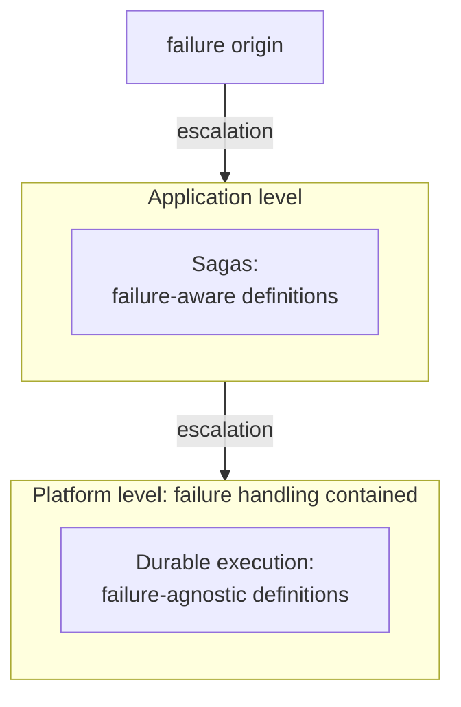

# 11. Durable executions

[← 10. Distributed consensus](10-distributed-consensus.md) · [Book](../README.md) · [12. Cloud and services →](12-cloud-and-services.md)

## Summary

**Durable executions** are to distributed systems what transactions are to databases: an abstraction that hides the possibility of failure (p. 145). The problem is **partial execution**. A signup function that charges a card and then creates an account can crash in between, leaving the user charged and locked out, because **failure atomicity doesn't compose**: a sequence of two atomic actions isn't atomic (pp. 145–148).

The chapter separates *definitions* (failure-aware or failure-agnostic) from *executions* (failure-free, failure-tolerant or failure-transparent) (p. 147). It models processes as sequences of atomic steps and executions as traces that may crash (p. 148). It defines **failure-transparent recovery** relative to an application-chosen **equivalence function**: identity, duplicating the last event, duplicating the last n events, or a full restart (pp. 149–150). It compares **restart** and **resume** (pp. 150–151), then two implementations:

- **Sagas**, at the application level: failure-aware state machines (pp. 152–153).
- **Durable execution**, at the platform level: failure-agnostic code run by a runtime that either replays a **log** of step results or restores a saved **continuation** (pp. 153–155).

## Key takeaways

- **Failure atomicity doesn't compose:** t | ⚡ ≡ a prefix of t. The goal is t | ⚡ ≡ t, or nothing (p. 146).
- **Two flavors of atomicity.** *Concurrency* atomicity: observably equivalent to uninterrupted, with intermediate states hidden (databases call this isolation). *Failure* atomicity: all or nothing, but intermediate states may be visible. Failure atomicity is what correctness usually requires (pp. 146–147).
- **Definition vs. execution.** Failure-aware and failure-agnostic describe *code*; failure-free, failure-tolerant and failure-transparent describe *running code* (p. 147).
- **Short-running vs. long-running** (from the Sagas paper) is about *logical* time: one step versus several, not seconds versus days (p. 149).
- **Failure-transparent recovery:** a failed, recovered and continued execution is *equivalent* to a failure-free one. Transient and intermittent failures can't stop it from completing; permanent failures can (p. 149).
- **Equivalence is chosen by the application.** Identity amounts to exactly-once processing, which isn't always achievable, so practical choices allow duplicating the last event or the last n events, up to a full restart. Duplicates require **idempotent** steps (pp. 149–150).
- **Restart** is simple but breaks delays (it resets a one-week timer) and nondeterminism (the time, random numbers). **Resume** continues from the last save point (pp. 150–151).
- **Sagas** make the code failure-aware and obscure the business logic. **Log-based durable execution** needs determinism and a growing log. **State-based durable execution** needs serializable continuations, which few runtimes support (pp. 152–155).

## Section outline

*From the book’s own table of contents (PDF bookmarks); printed page numbers.*

- 11.1 The pitfalls of partial executions — p. 145
- 11.2 System model — p. 147
  - 11.2.1 Process definition — p. 148
  - 11.2.2 Process execution — p. 148
- 11.3 The concept of failure-transparent recovery — p. 149
- 11.4 Strategies of failure-transparent recovery — p. 150
  - 11.4.1 Restart — p. 150
  - 11.4.2 Resume — p. 151
- 11.5 Implementation of failure-transparent recovery — p. 152
  - 11.5.1 Application-level implementation: Sagas — p. 152
  - 11.5.2 Platform-level implementation: Durable execution — p. 153

## Notes

### 11.1 The pitfalls of partial executions

The chapter opens with an epigraph from "An Equational Theory for Transactions" (Black, Cremet, Guerraoui and Odersky): under partial failure, even basic rules of reasoning about computation fail (p. 145).

The example is a streaming platform's `signup` (Listing 11.1): `await Payment.create(…)`, then `await Account.create(…)`. It handles only the happy path. A crash between the two calls charges the user without granting access (pp. 145–146).

| Notation | Meaning (p. 146) |
|---|---|
| a, b | Two atomic actions |
| a•b | Their sequential composition, which is **not** atomic (Figure 11.1) |
| t \| ⚡ ≡ prefix t | What we get: a crash leaves some prefix of the execution |
| t \| ⚡ ≡ t or nothing | What we want: **failure transparency** |

**Aha! moment, two flavors of atomicity** (pp. 146–147):

| Flavor | Observably equivalent to… | Intermediate states visible to others? |
|---|---|---|
| **Concurrency** atomicity | Running uninterrupted (databases call this *isolation*) | No |
| **Failure** atomicity | All or nothing | Yes |

The chapter uses *atomic* to mean failure-atomic. A process moves from a correct state through an incorrect intermediate state (charged, no account) to a correct one. Failure atomicity guarantees the process never *stops* in that middle state (p. 147).

### 11.2 System model

The section opens with a Dijkstra epigraph: the programmer's real subject is the *execution* their definition controls (p. 147). We often blur definition (the code) and execution (the running code); Figure 11.2 separates them (p. 147):

| | Definition (static, development) | Execution (dynamic, operations) |
|---|---|---|
| Terms | Failure-**aware**, failure-**agnostic** | Failure-**free**, failure-**tolerant**, failure-**transparent** |

#### 11.2.1–11.2.2 Process definition and execution (p. 148)

- **Definition:** P = A • P′ | ε. Either perform the atomic action A and then behave like P′, or terminate successfully (ε).
- **Execution:** a trace t in which each step A is an observable event a. The model assumes **Crash-Stop** failures. For P = A • B • ε, the possible traces are × (crashed before a), a • × (crashed after a) and a • b • ✓ (success).
- A single-step process inherits its step's failure atomicity (Figure 11.3). A multi-step process doesn't: **failure atomicity doesn't compose** (Figure 11.4).

**Aha! moment** (p. 149): in "Sagas", Garcia-Molina and Salem define *short-running* (short-lived) as one step and *long-running* (long-lived) as several. This is about **logical time**, delineated by steps, not physical time.

### 11.3 The concept of failure-transparent recovery

Recovery is **failure-transparent** if a failure-free execution produces a sequence of events *equivalent* to that of a failed, recovered and continued execution. Transient and intermittent failures can't prevent completion; permanent failures can (p. 149). The chapter covers only **forward** recovery; compensation is in Chapter 3 (p. 149).

Equivalence is decided by an application-specific **equivalence function** (p. 149). For `alphabet()`, which prints a to f, one letter per step (Listing 11.2), P = A•B•C•D•E•F•ε and the failure-free trace is a•b•c•d•e•f•✓ (pp. 149–150). With a crash 💥 after c:

| Equivalence function | Recovered trace (p. 150) | Note |
|---|---|---|
| **Identity** | a•b•c💥d•e•f•✓ | Ideal, but amounts to exactly-once processing, which isn't always achievable |
| **Valid to duplicate the last event** | a•b•c💥c•d•e•f•✓ | Apt and popular |
| **Valid to duplicate the last n events** | a•b•c💥b•c•d•e•f•✓ | Here n = 2 |
| **Restart** (the extreme case) | a•b•c💥a•b•c•d•e•f•✓ | Duplicates everything done so far |

> **Vault note:** the book's text refers back to "chapter 6" for exactly-once processing and idempotence (pp. 150–151); both are covered in [Chapter 4](04-message-delivery-and-processing.md).

### 11.4 Strategies of failure-transparent recovery

Duplicated events are only correct if actions are **idempotent** (p. 150).

| Strategy | How | Limits (pp. 150–151) |
|---|---|---|
| **Restart** | Run the process again from the beginning | Simple *if* steps are idempotent. Breaks **delays**: in Listing 11.4, the account is created and payment is collected after a one-week `setTimeout`, so a restart resets the week. Breaks **nondeterministic** steps: the time of day or a random number may differ on rerun |
| **Resume** | Restart from the most recent **save point**: load state, run a step, save state (Figure 11.5) | Needs enough information captured between steps |

### 11.5 Implementation of failure-transparent recovery

*A simplified reading of Figure 11.6, the failure-handling ladder (p. 152):* failure-aware levels handle failures explicitly; failure-oblivious levels above a containment point never see them.

#### 11.5.1 Application-level implementation: Sagas (pp. 152–153)

**Sagas** are failure-*aware* definitions that yield failure-transparent executions. A common implementation is a **state machine** whose state and next-step trigger are persisted after every step, enabling *eventual* execution (Listing 11.5):

- state `createAccount` runs `AccountCreate()` and returns `{label: 'createPayment', account}`;
- state `createPayment` runs `PaymentCreate()` and returns `{label: 'done', payment}`.

In the author's opinion this **obscures the core business logic**, making it harder to understand and maintain (p. 153).

#### 11.5.2 Platform-level implementation: Durable execution (pp. 153–155)

**Durable executions** are failure-*agnostic* definitions that yield failure-transparent executions. In Listing 11.6, `signup` is a generator (a coroutine) that *yields* each step as a function, and a runtime executes them. There are two strategies:

| | **Log-based** (Listing 11.7) | **State-based** (Listing 11.8) |
|---|---|---|
| Records after each step | The step's **output**, in a durable log | The execution's **state**, more precisely its continuation |
| On recovery | Restart the coroutine and **replay**: for each step already in the log, feed the logged result back instead of executing, fast-forwarding to the failure point | **Load** the saved continuation and continue, without replay |
| Requires | **Deterministic** execution, so replay follows the same path as the log | **Serializable continuations**, a language or runtime feature |
| Drawback | The log grows with every step | Most runtimes lack it today; early examples are Grain and Unison |
| Support needed | None special: simple to implement | Native support, a compiler extension or libraries |

(pp. 153–155)

> **Try it:** [Restart, resume and replay](../widgets/11-durable-execution.html) — run the book's `alphabet()` process, crash it after any step, and recover it by restart, by resuming from a save point, or by log-based replay; compare the resulting event sequences with each equivalence function, then add a nondeterministic step and watch replay diverge.

## Trade-offs at a glance

| Approach | Definition stays… | Recovery cost | Requires | Breaks on |
|---|---|---|---|---|
| Naive code (Listing 11.1) | Failure-agnostic | — | — | Any crash between steps: partial execution |
| Restart | Failure-agnostic | Re-run every step | Idempotent steps | Delays, nondeterminism |
| Resume from save points | Failure-aware (save and load) | Re-run the last step | Captured state | Forgetting to save |
| Saga (state machine) | **Failure-aware** | Re-run the current state's step | Persisted state, idempotent steps | Readability |
| Durable execution, log-based | **Failure-agnostic** | Replay the log, run the rest | Determinism | Nondeterministic code; very long logs |
| Durable execution, state-based | **Failure-agnostic** | None: continue | Serializable continuations | Runtimes without support |

## Beyond the book

- **Workflow engines in practice.** Temporal, Restate, AWS Step Functions and Azure Durable Functions are durable-execution platforms. Temporal and Durable Functions are log-based: they replay workflow code against an event history, which is why their workflow code must be deterministic and why they provide APIs for time, randomness and side effects that record their results. This is the vault's context; the chapter names no products besides Grain and Unison.
- **Sagas with compensation.** The original Sagas paper pairs each step with a compensating action for *backward* recovery, the "correct but less desirable" outcome of [Chapter 3](03-failure-tolerance.md). The book's chapter only covers forward recovery (p. 149).
- **Replay with a test.** The [durable-execution lab](../lab/11-durable-replay/README.md) implements Listing 11.7's log-based runtime with Python generators, injects a crash after every step and checks that each recovered execution matches the failure-free trace under the "duplicate the last event" equivalence. It also shows that a nondeterministic step breaks replay.

## Connections

- **Related chapters:** [3. Failure tolerance](03-failure-tolerance.md) (total vs. partial application, forward vs. backward recovery), [4. Message delivery and processing](04-message-delivery-and-processing.md) (exactly-once semantics and idempotence), [5. Transactions](05-transactions.md) (the abstraction durable executions imitate), [6. Distributed transactions](06-distributed-transactions.md) (atomicity across systems with 2PC instead), [8. Replication](08-replication.md) (state-based vs. log-based, again).
- **Run it:** [Log-based durable execution](../lab/11-durable-replay/README.md) — a generator-based runtime with a durable log; crashes after every step, recovers by replay, and compares traces with and without a nondeterministic step.

## Check yourself

*Questions and answers are the vault's, written from the notes above; answers cite the book's pages.*

1. **What goes wrong with Listing 11.1, and what general principle does it show?**

   *Answer:* A crash after charging and before creating the account leaves the user charged without access. The sequential composition of atomic actions isn't atomic: failure atomicity doesn't compose (pp. 146–148).

2. **Which terms describe definitions, and which describe executions?**

   *Answer:* Definitions: failure-aware, failure-agnostic. Executions: failure-free, failure-tolerant, failure-transparent (p. 147).

3. **What does "long-running" mean in the Sagas sense?**

   *Answer:* An execution with more than one step. It's a statement about logical time, not physical duration (p. 149).

4. **After a crash following step c, which recovered trace matches "valid to duplicate the last event"?**
   - [ ] a•b•c💥d•e•f•✓
   - [x] a•b•c💥c•d•e•f•✓
   - [ ] a•b•c💥a•b•c•d•e•f•✓

   *Answer:* The last event, c, appears twice. The first option is identity; the third is restart (p. 150).

5. **Name two situations where restart is the wrong recovery strategy.**

   *Answer:* A delayed step (restarting resets the one-week delay before payment) and nondeterministic steps such as reading the time or generating random numbers (p. 151).

6. **Why does the author prefer durable execution to sagas?**

   *Answer:* Sagas make the definition failure-aware, which obscures the business logic. Durable executions keep the code failure-agnostic (pp. 152–153).

7. **What does each durable-execution strategy require?**

   *Answer:* Log-based needs deterministic execution, and its log keeps growing. State-based needs serializable continuations, which most runtimes don't yet provide (pp. 154–155).
