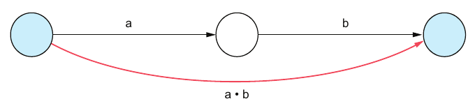
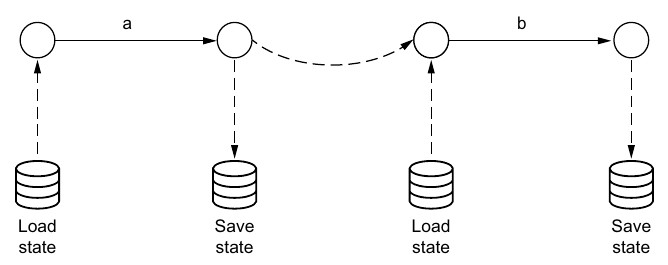
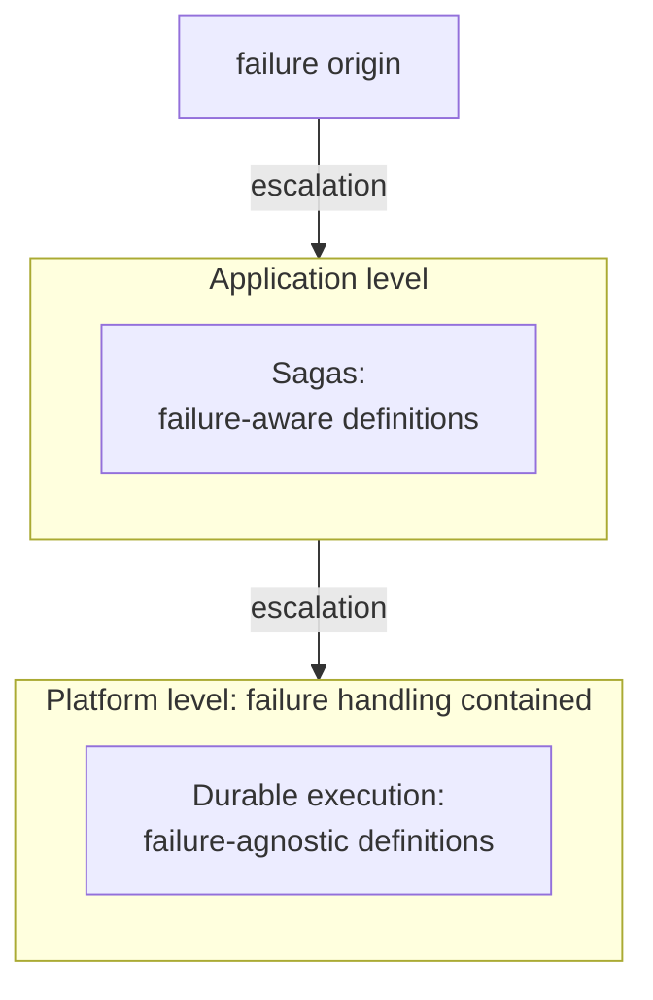

# فصل ۱۱: اجرای پایا

[فصل ۱۰: consensus توزیع‌شده →](10-distributed-consensus.md) · [کتاب](../README.md) · [فصل ۱۲: cloud و سرویس‌ها ←](12-cloud-and-services.md)

## خلاصه

**اجرای پایا** برای سیستم‌های توزیع‌شده همان است که تراکنش برای دیتابیس‌ها: انتزاعی که احتمال شکست را پنهان می‌کند (p. 145). مسئله **اجرای جزئی** است. تابع ثبت‌نامی که کارتی را شارژ می‌کند و بعد حسابی می‌سازد می‌تواند میان این دو از کار بیفتد، و کاربر را شارژشده و بی‌راه بگذارد، چون **اتمی بودن در برابر شکست ترکیب نمی‌شود**: دنباله‌ای از دو کنش اتمی اتمی نیست (pp. 145–148).

فصل *تعریف*ها، یعنی شکست‌آگاه یا شکست‌ناآگاه، را از *اجرا*ها، یعنی بی‌شکست یا شکست‌تحمل یا شکست‌شفاف، جدا می‌کند (p. 147). processها را به‌شکل دنباله‌ای از قدم‌های اتمی و اجراها را به‌شکل ردهایی که می‌توانند از کار بیفتند مدل می‌کند (p. 148). **بازیابی failure-transparent** را نسبت به **تابع هم‌ارزی**ی که برنامه برمی‌دارد تعریف می‌کند: همانی، تکرار آخرین رویداد، تکرار n رویداد آخر، یا شروع دوباره‌ی کامل (pp. 149–150). **شروع دوباره** و **ادامه** را مقایسه می‌کند (pp. 150–151)، و بعد دو پیاده‌سازی:

- **الگوی Saga**ها، در سطح برنامه: ماشین‌های حالت شکست‌آگاه (pp. 152–153).
- **اجرای پایا**، در سطح پلتفرم: کدی شکست‌ناآگاه که runtimeی اجرایش می‌کند و یا **log**ی از نتیجه‌ی قدم‌ها را replay می‌کند یا **continuation** ذخیره‌شده‌ای را بازمی‌گرداند (pp. 153–155).

## نکته‌های کلیدی

- **اتمی بودن در برابر شکست ترکیب نمی‌شود:** داریم t | ⚡ ≡ پیشوندی از t. هدف t | ⚡ ≡ t است، یا هیچ (p. 146).
- **دو مزه از اتمی بودن.** اتمی بودن در برابر *concurrency*: به‌شکل مشاهده‌پذیر هم‌ارز با بی‌وقفه بودن، با حالت‌های میانی پنهان، که دیتابیس‌ها اسمش را isolation می‌گذارند. اتمی بودن در برابر *شکست*: همه یا هیچ، ولی حالت‌های میانی می‌توانند دیده شوند. درستی معمولاً اتمی بودن در برابر شکست را می‌خواهد (pp. 146–147).
- **تعریف در برابر اجرا.** شکست‌آگاه و شکست‌ناآگاه *کد* را وصف می‌کنند؛ و بی‌شکست و شکست‌تحمل و failure-transparent *کد در حال اجرا* را (p. 147).
- **کوتاه‌اجرا در برابر بلند‌اجرا**، از مقاله‌ی Sagas، درباره‌ی زمان *منطقی* است: یک قدم در برابر چند قدم، نه ثانیه در برابر روز (p. 149).
- **بازیابی failure-transparent:** اجرایی که شکسته و بازیابی و ادامه داده شده *هم‌ارز* اجرایی بی‌شکست است. شکست‌های transient و متناوب نمی‌توانند جلو تمام شدنش را بگیرند؛ و شکست‌های دائم می‌توانند (p. 149).
- **هم‌ارزی را برنامه برمی‌دارد.** همانی به پردازش exactly-once می‌رسد، که همیشه دست‌یافتنی نیست، پس گزینه‌های عملی تکرار آخرین رویداد یا n رویداد آخر را مجاز می‌کنند، تا شروع دوباره‌ی کامل. تکراری‌ها قدم‌های **idempotent** لازم دارند (pp. 149–150).
- **شروع دوباره** ساده است ولی latencyها را می‌شکند، یعنی تایمر یک‌هفته‌ای را صفر می‌کند، و ناقطعیت را، یعنی زمان و عددهای تصادفی. **ادامه** از آخرین نقطه‌ی ذخیره پی می‌گیرد (pp. 150–151).
- **الگوی Saga**ها کد را شکست‌آگاه می‌کنند و منطق کسب‌و‌کار را می‌پوشانند. **اجرای پایای log‌محور** قطعیت و لاگی رونده لازم دارد. **اجرای پایای state-based** continuationهای serializable لازم دارد، که runtimeهای کمی پشتیبانی‌شان می‌کنند (pp. 152–155).

## فهرست بخش‌ها

*از فهرست مطالب خود کتاب، از bookmarkهای PDF؛ شماره‌ها صفحه‌ی چاپی‌اند.*

- ۱۱.۱ دام‌های اجرای جزئی — ص. ۱۴۵
- ۱۱.۲ مدل سیستم — ص. ۱۴۷
  - ۱۱.۲.۱ تعریف process — ص. ۱۴۸
  - ۱۱.۲.۲ اجرای process — ص. ۱۴۸
- ۱۱.۳ مفهوم بازیابی failure-transparent — ص. ۱۴۹
- ۱۱.۴ راهبردهای بازیابی failure-transparent — ص. ۱۵۰
  - ۱۱.۴.۱ شروع دوباره — ص. ۱۵۰
  - ۱۱.۴.۲ ادامه — ص. ۱۵۱
- ۱۱.۵ پیاده‌سازی بازیابی failure-transparent — ص. ۱۵۲
  - ۱۱.۵.۱ پیاده‌سازی در سطح برنامه: Sagaها — ص. ۱۵۲
  - ۱۱.۵.۲ پیاده‌سازی در سطح پلتفرم: اجرای پایا — ص. ۱۵۳

## یادداشت‌ها

### ۱۱.۱ دام‌های اجرای جزئی

فصل با سرلوحه‌ای از مقاله‌ی «An Equational Theory for Transactions»، از بلک و کرمه و گروائویی و اودرسکی، باز می‌شود: زیر شکست جزئی، حتی قاعده‌های پایه‌ی استدلال درباره‌ی محاسبه هم باز می‌مانند (p. 145).

نمونه، تابع `signup` یک پلتفرم استریم است (فهرست ۱۱.۱): اول `await Payment.create(…)`، بعد `await Account.create(…)`. تنها مسیر خوش را رسیدگی می‌کند. از کار افتادنی میان این دو فراخوانی کاربر را شارژ می‌کند بی آن‌که دسترسی بدهد (pp. 145–146).

| نماد | معنا (p. 146) |
|---|---|
| a، b | دو کنش اتمی |
| a•b | ترکیب ترتیبی‌شان، که اتمی **نیست** (شکل ۱۱.۱) |
| t \| ⚡ ≡ prefix t | آن چیزی که می‌گیریم: از کار افتادن پیشوندی از اجرا را می‌گذارد |
| t \| ⚡ ≡ t یا هیچ | آن چیزی که می‌خواهیم: **شفافیت در برابر شکست** |

*Figure 11.1 (p. 146): هر فلشی تنها اتمی است، ولی از کار افتادنی می‌تواند سیستم را در حالت میانی بخواباند، پس آن فلش سرخ بلند اتمی نیست.*

**لحظه‌ی آها!، دو مزه از اتمی بودن** (pp. 146–147):

| مزه | به‌شکل مشاهده‌پذیر هم‌ارز با… | حالت‌های میانی برای دیگران دیدنی‌اند؟ |
|---|---|---|
| اتمی بودن در برابر **concurrency** | اجرای بی‌وقفه، که دیتابیس‌ها اسمش را *isolation* می‌گذارند | نه |
| اتمی بودن در برابر **شکست** | همه یا هیچ | بله |

فصل واژه‌ی *اتمی* را به معنای اتمی در برابر شکست به کار می‌برد. process از حالتی درست، از راه حالتی میانی و نادرست، یعنی شارژشده و بی‌حساب، به حالتی درست می‌رود. اتمی بودن در برابر شکست تضمین می‌کند که process هیچ‌وقت در آن حالت میانی *نمی‌ایستد* (p. 147).

> **In practice:** DAG در Airflow اجرای چندمرحله‌ای است: load، hash، staging، Bronze، Silver، Gold؛ و هر مرحله ممکن است وسط کار بمیرد.
>
> **Your turn:** task ساختن Silver بعد از نوشتن نیمی از ردیف‌ها kill شد و retry می‌شود. چه چیزی باید درست باشد تا نتیجه درست بماند؟
>
> *Answer:* task باید یا اتمی باشد، مثلاً ساختن در جدول staging و `EXCHANGE`، یا idempotent، مثلاً بازنویسی partition. وگرنه retry نیمه‌ی اول را تکراری می‌کند. اجرای جزئی حالت میانی‌ای باقی می‌گذارد که retry ساده نمی‌بیند (pp. 145–147).

### ۱۱.۲ مدل سیستم

بخش با سرلوحه‌ای از دایکسترا باز می‌شود: موضوع واقعی برنامه‌نویس همان *اجرا*یی است که تعریفش کنترلش می‌کند (p. 147). ما اغلب تعریف، یعنی کد، و اجرا، یعنی کد در حال اجرا، را قاطی می‌کنیم؛ شکل ۱۱.۲ جدایشان می‌کند (p. 147):

| | تعریف که ایستا و زمان توسعه است | اجرا که پویا و زمان عملیات است |
|---|---|---|
| اصطلاح‌ها | شکست‌**آگاه**، شکست‌**ناآگاه** | **بی‌شکست**، **شکست‌تحمل**، **failure-transparent** |

#### ۱۱.۲.۱ و ۱۱.۲.۲ تعریف و اجرای process (p. 148)

- **تعریف:** داریم P = A • P′ | ε. یا کنش اتمی A را انجام بده و بعد مثل P′ رفتار کن، یا موفق تمام کن، یعنی ε.
- **اجرا:** ردی مثل t که در آن هر قدم A رویدادی مشاهده‌پذیر مثل a است. مدل شکست‌های **Crash-Stop** را فرض می‌گیرد. برای P = A • B • ε، ردهای ممکن × هستند، یعنی پیش از a از کار افتاد، و a • ×، یعنی پس از a از کار افتاد، و a • b • ✓، یعنی موفقیت.
- مفهوم process یک‌قدمی اتمی بودن قدمش را به ارث می‌برد (شکل ۱۱.۳). process چند‌قدمی نه: **اتمی بودن در برابر شکست ترکیب نمی‌شود** (شکل ۱۱.۴).

**لحظه‌ی آها!** (p. 149): در مقاله‌ی «Sagas»، گارسیا-مولینا و سالم *کوتاه‌اجرا* را یک قدم و *بلند‌اجرا* را چند قدم تعریف می‌کنند. این درباره‌ی **زمان منطقی** است، که قدم‌ها مرزش می‌زنند، نه زمان فیزیکی.

### ۱۱.۳ مفهوم بازیابی failure-transparent

بازیابی **failure-transparent** است اگر اجرایی بی‌شکست دنباله‌ای از رویداد بسازد که *هم‌ارز* دنباله‌ی اجرایی شکسته و بازیابی و ادامه داده شده باشد. شکست‌های transient و متناوب نمی‌توانند جلو تمام شدن را بگیرند؛ و شکست‌های دائم می‌توانند (p. 149). فصل تنها بازیابی **روبه‌جلو** را می‌پوشاند؛ و جبران در فصل ۳ است (p. 149).

هم‌ارزی را **تابع هم‌ارزی**ی برنامه‌ویژه تصمیم می‌گیرد (p. 149). برای `alphabet()`، که a تا f را چاپ می‌کند و هر قدم یک حرف (فهرست ۱۱.۲)، داریم P = A•B•C•D•E•F•ε و رد بی‌شکست a•b•c•d•e•f•✓ است (pp. 149–150). با از کار افتادنی 💥 پس از c:

| تابع هم‌ارزی | رد بازیابی‌شده (p. 150) | یادداشت |
|---|---|---|
| **همانی** | a•b•c💥d•e•f•✓ | آرمانی، ولی به پردازش exactly-once می‌رسد، که همیشه دست‌یافتنی نیست |
| **تکرار آخرین رویداد مجاز است** | a•b•c💥c•d•e•f•✓ | برازنده و همه‌گیر |
| **تکرار n رویداد آخر مجاز است** | a•b•c💥b•c•d•e•f•✓ | این‌جا n = 2 |
| **شروع دوباره** که حالت حدی است | a•b•c💥a•b•c•d•e•f•✓ | هر چه تا این‌جا شده را تکرار می‌کند |

> **Vault note:** متن کتاب برای پردازش exactly-once و idempotence به «فصل ۶» پس‌ارجاع می‌دهد (pp. 150–151)؛ هر دو در [فصل ۴](04-message-delivery-and-processing.md) پوشش داده شده‌اند.

### ۱۱.۴ راهبردهای بازیابی failure-transparent

رویدادهای تکراری تنها وقتی درست‌اند که کنش‌ها **idempotent** باشند (p. 150).

| راهبرد | چطور | حدها (pp. 150–151) |
|---|---|---|
| **شروع دوباره** | process را از اول دوباره اجرا کن | ساده است *اگر* قدم‌ها idempotent باشند. **latency**ها را می‌شکند: در فهرست ۱۱.۴، حساب ساخته می‌شود و پرداخت پس از یک `setTimeout` یک‌هفته‌ای وصول می‌شود، پس شروع دوباره آن هفته را صفر می‌کند. قدم‌های **ناقطعی** را می‌شکند: شاید ساعت روز یا عددی تصادفی سر اجرای دوباره فرق کند |
| **ادامه** | از تازه‌ترین **نقطه‌ی ذخیره** دوباره شروع کن: حالت را بار کن، قدمی بردار، حالت را ذخیره کن (شکل ۱۱.۵) | به اطلاع کافی که بین قدم‌ها گرفته شده نیاز دارد |

*Figure 11.5 (p. 151): پس از از کار افتادن، اجرا از آخرین نقطه‌ی ذخیره پی گرفته می‌شود، پس قدمی که تمام شده هیچ‌وقت دوباره نمی‌شود.*

### ۱۱.۵ پیاده‌سازی بازیابی failure-transparent

*خوانشی ساده‌شده از شکل ۱۱.۶، یعنی نردبان رسیدگی به شکست (p. 152):* سطح‌های شکست‌آگاه شکست‌ها را صریح رسیدگی می‌کنند؛ و سطح‌های شکست‌نابین بالای نقطه‌ی مهار هیچ‌وقت نمی‌بینندشان.

#### ۱۱.۵.۱ پیاده‌سازی در سطح برنامه: Sagaها (pp. 152–153)

**الگوی Saga**ها تعریف‌هایی شکست‌*آگاه*اند که اجرایی failure-transparent می‌دهند. پیاده‌سازی رایجشان **state machine**ی است که حالت و برانگیزنده‌ی قدم بعدش پس از هر قدمی پایا می‌شوند، که اجرای *غایی* را ممکن می‌کند (فهرست ۱۱.۵):

- حالت `createAccount` تابع `AccountCreate()` را اجرا می‌کند و `{label: 'createPayment', account}` برمی‌گرداند؛
- و حالت `createPayment` تابع `PaymentCreate()` را اجرا می‌کند و `{label: 'done', payment}` برمی‌گرداند.

به نظر نویسنده این **منطق مغزی کسب‌و‌کار را می‌پوشاند**، و فهمیدن و نگهداشتش را سخت‌تر می‌کند (p. 153).

#### ۱۱.۵.۲ پیاده‌سازی در سطح پلتفرم: اجرای پایا (pp. 153–155)

**اجرای پایا** تعریف‌هایی شکست‌*ناآگاه*اند که اجرایی failure-transparent می‌دهند. در فهرست ۱۱.۶، تابع `signup` یک generator است، یعنی coroutine، که هر قدمی را به‌شکل تابعی *yield* می‌کند، و runtimeی اجرایشان می‌کند. دو راهبرد هست:

| | **log‌محور** (فهرست ۱۱.۷) | **state-based** (فهرست ۱۱.۸) |
|---|---|---|
| پس از هر قدمی چه ثبت می‌کند | **خروجی** قدم، در لاگی پایا | **حالت** اجرا، و دقیق‌تر continuationش |
| سر بازیابی | coroutine را دوباره شروع کن و **replay** کن: برای هر قدمی که از قبل در لاگ است، به‌جای اجرا نتیجه‌ی لاگ‌شده را برگردان، و تا نقطه‌ی شکست جلو برو | continuation ذخیره‌شده را **بار** کن و ادامه بده، بی replay |
| چه لازم دارد | اجرای **قطعی**، تا replay همان مسیر لاگ را پی بگیرد | **continuationهای serializable**، که امکانی در زبان یا runtime است |
| اشکال | لاگ با هر قدمی رشد می‌کند | امروز بیشتر runtimeها ندارندش؛ نمونه‌های اولیه Grain و Unison‌اند |
| چه پشتیبانی لازم است | هیچ چیز خاصی: پیاده‌سازی‌اش ساده است | پشتیبانی بومی، افزونه‌ای بر compiler، یا کتابخانه |

(pp. 153–155)

> **Try it:** [شروع دوباره، ادامه و replay](../widgets/11-durable-execution.html)؛ process `alphabet()` کتاب را اجرا کنید، پس از هر قدمی از کارش بیندازید، و با شروع دوباره یا ادامه از نقطه‌ی ذخیره یا replay log‌محور بازیابی‌اش کنید؛ دنباله‌ی رویدادهای حاصل را با هر تابع هم‌ارزی مقایسه کنید، بعد قدمی ناقطعی بیفزایید و ببینید replay واگرا می‌شود.

> **In practice:** Airflow نوعی durable execution در سطح task است: state هر task در دیتابیس metadata ذخیره می‌شود و DAG از task شکست‌خورده ادامه می‌یابد، نه از اول.
>
> **Your turn:** چرا یک task بزرگ که همه‌ی لایه‌ها را می‌سازد بدتر از شش task کوچک است؟
>
> *Answer:* Airflow فقط مرز taskها را checkpoint می‌کند؛ task بزرگ با هر شکست از اول اجرا می‌شود. taskهای کوچک‌تر و idempotent یعنی بازیابی از نزدیک‌ترین نقطه، همان‌طور که در Saga هر گام جدا ثبت می‌شود (pp. 152–155).

## بده‌بستان‌ها در یک نگاه

| رویکرد | تعریف … می‌ماند | هزینه‌ی بازیابی | چه لازم دارد | کجا می‌شکند |
|---|---|---|---|---|
| کد ساده‌دل (فهرست ۱۱.۱) | شکست‌ناآگاه | — | — | هر از کار افتادنی بین قدم‌ها: اجرای جزئی |
| شروع دوباره | شکست‌ناآگاه | هر قدمی دوباره اجرا می‌شود | قدم‌های idempotent | تأخیرها، ناقطعیت |
| ادامه از نقطه‌های ذخیره | شکست‌آگاه، یعنی ذخیره و بار کردن | آخرین قدم دوباره اجرا می‌شود | حالتی که گرفته شده | از یاد بردن ذخیره |
| Saga که state machine است | **شکست‌آگاه** | قدم حالت جاری دوباره اجرا می‌شود | حالت پایا، قدم‌های idempotent | خوانایی |
| اجرای پایای log‌محور | **شکست‌ناآگاه** | لاگ را replay کن، بقیه را اجرا | قطعیت | کد ناقطعی؛ لاگ‌های خیلی بلند |
| اجرای پایای state-based | **شکست‌ناآگاه** | هیچ: ادامه بده | continuationهای serializable | runtimeهای بی پشتیبانی |

## فراتر از کتاب

- **موتورهای workflow در عمل.** پلتفرم‌های Temporal و Restate و AWS Step Functions و Azure Durable Functions پلتفرم‌های اجرای پایا هستند. Temporal و Durable Functions لاگ‌محورند: کد workflow را روی تاریخی از رویداد replay می‌کنند، که از همین‌جاست که کد workflowشان باید قطعی باشد و از همین‌جاست که API می‌دهند تا زمان و تصادفی بودن و اثرهای جانبی نتیجه‌شان را ثبت کنند. این بافتار مال vault است؛ فصل جز Grain و Unison نام محصولی نمی‌برد.
- **همه‌ی Sagaها با جبران.** مقاله‌ی اصلی Sagas هر قدمی را با کنشی جبرانی برای بازیابی *روبه‌عقب* جفت می‌کند، که همان برآمد «درست ولی کم‌دلخواه‌تر» [فصل ۳](03-failure-tolerance.md) است. این فصل کتاب تنها بازیابی روبه‌جلو را می‌پوشاند (p. 149).
- **عمل replay با یک آزمون.** [آزمایش اجرای پایا](../lab/11-durable-replay/README.md) runtime لاگ‌محور فهرست ۱۱.۷ را با generatorهای Python پیاده می‌کند، پس از هر قدمی از کار افتادنی تزریق می‌کند و می‌سنجد که هر اجرای بازیابی‌شده زیر هم‌ارزی «تکرار آخرین رویداد» با رد بی‌شکست می‌خواند. همچنین نشان می‌دهد قدمی ناقطعی replay را می‌شکند.

## پیوندها

- **فصل‌های مرتبط:** [فصل ۳: تحمل شکست](03-failure-tolerance.md) که اعمال کلی در برابر جزئی و بازیابی روبه‌جلو در برابر روبه‌عقب را دارد، [فصل ۴: تحویل و پردازش پیام](04-message-delivery-and-processing.md) که معناشناسی exactly-once و idempotence را دارد، [فصل ۵: تراکنش](05-transactions.md) که همان انتزاعی است که اجرای پایا تقلیدش می‌کند، [فصل ۶: تراکنش توزیع‌شده](06-distributed-transactions.md) که اتمی بودن بین سیستم‌ها را در عوض با 2PC دارد، و [فصل ۸: replication](08-replication.md) که بازهم state-based در برابر log‌محور را دارد.
- **Run it:** [اجرای پایای log‌محور](../lab/11-durable-replay/README.md)؛ runtimeی generator‌محور با لاگی پایا؛ پس از هر قدمی از کار می‌افتد، با replay بازیابی می‌شود، و ردها را با و بی قدمی ناقطعی مقایسه می‌کند.

## خودتان را بسنجید

*پرسش‌ها و پاسخ‌ها مال vault است و از روی یادداشت‌های بالا نوشته شده؛ پاسخ‌ها به صفحه‌های کتاب ارجاع می‌دهند.*

1. **در فهرست ۱۱.۱ چه چیزی خراب می‌شود، و چه قاعده‌ی کلی‌ای را نشان می‌دهد؟**

   *Answer:* از کار افتادنی پس از شارژ و پیش از ساختن حساب کاربر را شارژشده و بی دسترسی می‌گذارد. ترکیب ترتیبی کنش‌های اتمی اتمی نیست: اتمی بودن در برابر شکست ترکیب نمی‌شود (pp. 146–148).

2. **کدام اصطلاح‌ها تعریف‌ها را وصف می‌کنند، و کدام‌ها اجراها را؟**

   *Answer:* تعریف‌ها: شکست‌آگاه، شکست‌ناآگاه. اجراها: بی‌شکست، شکست‌تحمل، failure-transparent (p. 147).

3. **«بلند‌اجرا» به معنای Sagas چه معنایی دارد؟**

   *Answer:* اجرایی با بیشتر از یک قدم. گزاره‌ای درباره‌ی زمان منطقی است، نه مدت فیزیکی (p. 149).

4. **پس از از کار افتادنی در پی قدم c، کدام رد بازیابی‌شده با «تکرار آخرین رویداد مجاز است» می‌خواند؟**
   - [ ] a•b•c💥d•e•f•✓
   - [x] a•b•c💥c•d•e•f•✓
   - [ ] a•b•c💥a•b•c•d•e•f•✓

   *Answer:* آخرین رویداد، یعنی c، دو بار می‌آید. گزینه‌ی اول همانی است؛ و سومی شروع دوباره (p. 150).

5. **دو وضعیتی را نام ببرید که در آن شروع دوباره راهبرد بازیابی نادرستی است.**

   *Answer:* قدمی تأخیردار، که شروع دوباره آن latency یک‌هفته‌ای پیش از پرداخت را صفر می‌کند، و قدم‌های ناقطعی مثل خواندن زمان یا ساختن عدد تصادفی (p. 151).

6. **چرا نویسنده اجرای پایا را به Sagaها ترجیح می‌دهد؟**

   *Answer:* Sagaها تعریف را شکست‌آگاه می‌کنند، که منطق کسب‌و‌کار را می‌پوشاند. اجرای پایا کد را شکست‌ناآگاه نگه می‌دارد (pp. 152–153).

7. **هر راهبرد اجرای پایا چه لازم دارد؟**

   *Answer:* لاگ‌محور اجرای قطعی لازم دارد، و لاگش همین‌طور رشد می‌کند. state-based continuationهای serializable لازم دارد، که بیشتر runtimeها هنوز نمی‌دهندشان (pp. 154–155).
