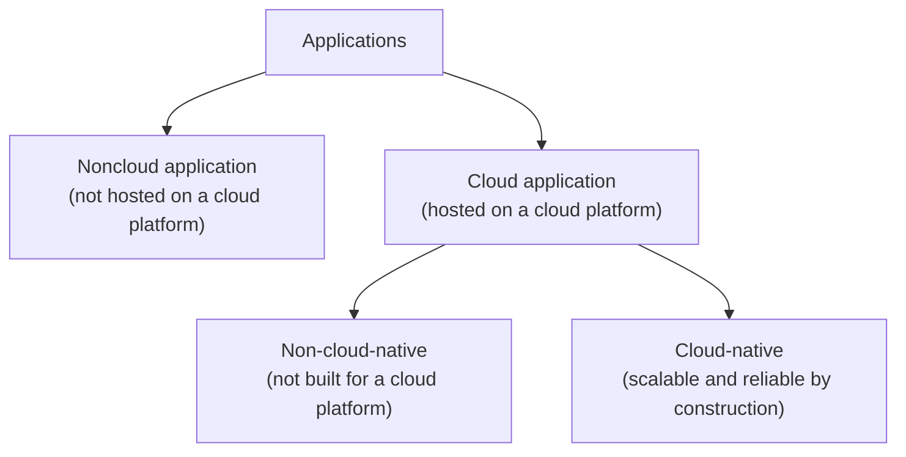
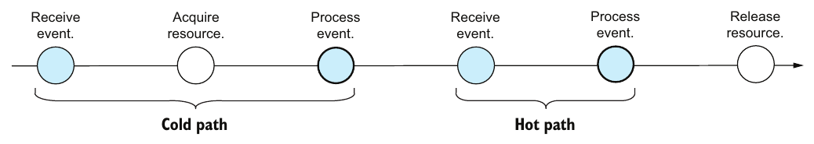
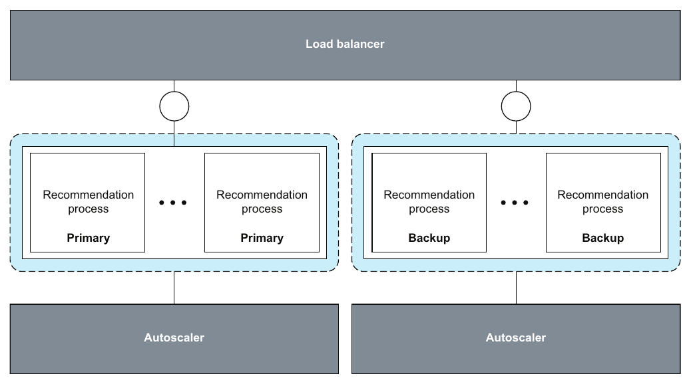
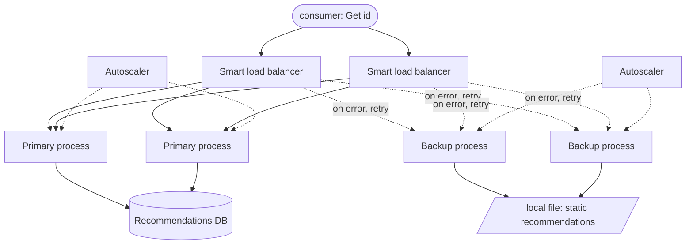

# فصل ۱۲: cloud و سرویس‌ها

[فصل ۱۱: اجرای پایا →](11-durable-executions.md) · [کتاب](../README.md)

## خلاصه

واژه‌های cloud و cloud-native و serverless و microservices همه‌جا هستند، ولی معناهایشان مبهم. همین «پارادوکس همه‌گیری» انگیزه‌ی فصل آخر است، که تعریف‌های دقیق و موجز نویسنده را عرضه می‌کند. با فهم صنعت سازگارند ولی استاندارد صنعت نیستند (p. 156).

فصل از آن جابه‌جایی شروع می‌کند که نویسنده بین ۲۰۰۸ و ۲۰۱۸ در SAP از سر گذراند، از VMهای تیکت‌محور به ماشین‌های درخواستی. همین سیستم‌ها را از **پیش‌کنشی و ایستا** به **واکنشی و پویا** تبدیل کرد، و **کشسانی** را ممکن (p. 157). بعد تعریف‌ها را می‌سازد:

- **محاسبات cloud** consumer منبع را از تأمین‌کننده‌ی منبع جدا می‌کند، که می‌گذارد منبع درخواستی گرفته و رها شود (pp. 157–158).
- **مفهوم cloud-native** یعنی مقیاس‌پذیر و قابل اطمینان *بنا به ساخت*، و نه فقط میزبانی‌شده در cloud (pp. 158–159).
- **مفهوم serverless** یعنی منبع‌ها *پس از* رسیدن رویداد گرفته می‌شوند، با **مسیر سرد و گرم** (pp. 159–161).
- **سرویس** یک *قرارداد* میان یک مؤلفه و بقیه‌ی سیستم است، نه آن مجموعه از مؤلفه‌ها که پیاده‌اش می‌کنند. سرویس پیشنهاد فیلم از یک process به تاری پویا از process و load balancer و autoscaler رشد می‌کند در حالی که قراردادش ثابت می‌ماند (pp. 161–166).

کتاب با گروهی موسیقی تمام می‌شود که نوازنده‌هایش همان نت را طور دیگری می‌خوانند، و با فراخوانی به بیشینه کردن هم‌پوشانی مدل‌های ذهنی ما و واقعیت (p. 166).

## نکته‌های کلیدی

- **کشسانی** یعنی رسیدن به مقیاس‌پذیری و قابلیت اطمینان با گرفتن و رها کردن درخواستی منبع (شکل ۱۲.۱). منبع‌های دیرزیست و خوش‌شناخته را با کوتاه‌زیست‌ها عوض کرد، و توپولوژی ایستا را با توپولوژی پویا و خودتنظیم (p. 157).
- **محاسبات cloud** برابر consumer منبع به‌علاوه‌ی تأمین‌کننده‌ی منبع به‌علاوه‌ی گرفتن و رها کردن درخواستی است. پلتفرم‌ها عمومی‌اند، مثل AWS و Google Cloud و Azure، یا خصوصی، مثل OpenStack و Cloud Foundry و Kubernetesی که شرکت می‌گرداند (pp. 157–158).
- **برنامه‌ی cloud** هر برنامه‌ای است که روی پلتفرمی cloud میزبانی شده. **برنامه‌ی cloud-native** *بنا به ساخت* مقیاس‌پذیر و قابل اطمینان است و گرفتن و رها کردن cloud را به کار می‌برد؛ آن کیفیت‌ها *تأمین‌شده*اند و نه فقط خواسته‌شده (p. 158).
- **قطعه‌های سازنده‌ی پلتفرم:** **supervisor** منبع‌های شکسته را عوض می‌کند، **scaler** منبع را با تقاضا جور می‌کند و **load balancer** درخواست‌ها را پخش. در Kubernetes این‌ها یک Deployment و یک HorizontalPodAutoscaler و یک Service‌اند (pp. 158–159).
- **بردار و بگذار** سود محدودی می‌آورد. نصب خالی WordPress در cloud کلود-نیتیو نیست، چون تشخیص و کاهش بار و شکست ندارد. container و microservice انتخاب فناوری و معماری‌اند و نه خود تعریف (p. 159).
- **سنتی:** گرفتن ← گرفتن رویداد ← پردازش ← رها کردن. **serverless:** گرفتن رویداد ← گرفتن منبع ← پردازش ← رها کردن، پس سیستم باید منبع‌های لازمش را *از خود رویداد* در بیاورد (pp. 160–161).
- **مسیر سرد:** گرفتن منبع میان گرفتن رویداد و پردازش رخ می‌دهد. **مسیر گرم:** منبع‌ها از رویدادهای پیشین از قبل در دست‌اند (p. 161).
- **سرویس قرارداد است، نه مؤلفه.** از نگاه محلی یک مؤلفه، فقط خودش هست و «بقیه‌ی سیستم». پیاده‌سازی سرویس پیشنهاد مدام عوض می‌شود؛ و قراردادش، یعنی Get: ID → [ID]، تنها ثابت است (pp. 162–166).

## فهرست بخش‌ها

*از فهرست مطالب خود کتاب، از bookmarkهای PDF؛ شماره‌ها صفحه‌ی چاپی‌اند.*

- ۱۲.۱ از پیش‌کنشی به واکنشی — ص. ۱۵۷
- ۱۲.۲ محاسبات cloud — ص. ۱۵۷
- ۱۲.۳ محاسبات cloud-native — ص. ۱۵۸
- ۱۲.۴ محاسبات serverless — ص. ۱۵۹
  - ۱۲.۴.۱ سنتی — ص. ۱۶۰
  - ۱۲.۴.۲ serverless — ص. ۱۶۰
  - ۱۲.۴.۳ مسیر سرد در برابر مسیر گرم — ص. ۱۶۱
- ۱۲.۵ سرویس — ص. ۱۶۱
  - ۱۲.۵.۱ نگاه جهانی در برابر نگاه محلی — ص. ۱۶۲
  - ۱۲.۵.۲ نمونه: سرویس پیشنهاد — ص. ۱۶۳
- ۱۲.۶ اندیشه‌های پایانی — ص. ۱۶۶

## یادداشت‌ها

### ۱۲.۱ از پیش‌کنشی به واکنشی

در SAP سال ۲۰۰۸، گرفتن یک ماشین مجازی یعنی تیکت پشتیبانی و تأیید مدیریت و انتظار برای تدارک، و پس از آن ماه‌ها config و نگهداشت. وقتی نویسنده یک دهه بعد رفت، دسته‌های VM درخواستی پیدا و ناپدید می‌شدند، و تنها حدشان بودجه بود (p. 157).

| | پیش از cloud | با cloud (p. 157) |
|---|---|---|
| منبع‌ها | کم، **دیرزیست**، خوش‌شناخته، با هویت و نشانی شبکه‌ی پایدار | زیاد، **کوتاه‌زیست**، با خاصیت‌های کوتاه‌زیست، به‌ویژه نشانی شبکه |
| موضع مهندسی | بار و شکست را **پیش‌بینی** کن و **پیش‌کنشی** رسیدگی‌شان کن | بار و شکست را **مشاهده** کن و **واکنشی** رسیدگی‌شان کن: سیستم‌ها خودتنظیم‌اند |
| توپولوژی | ایستا | پویا |

**کشسانی** توانایی رسیدن به مقیاس‌پذیری و قابلیت اطمینان با گرفتن و رها کردن درخواستی منبع است (شکل ۱۲.۱) (p. 157).

### ۱۲.۲ محاسبات cloud

محاسبات cloud دنیا را به **consumer منبع** و **تأمین‌کننده‌ی منبع** جدا می‌کند. consumer منبع‌هایی عملاً بی‌حد، مثل محاسبه با VM یا ذخیره‌سازی با دیسک، را درخواستی از یک **پلتفرم cloud** می‌گیرد و رها می‌کند (p. 157).

| پلتفرم | منبع به … عرضه می‌کند | نمونه‌ها (p. 158) |
|---|---|---|
| **عمومی** | بیرون سازمان خودش | AWS، Google Cloud Platform، Microsoft Azure |
| **خصوصی** | فقط درون سازمان خودش | نمونه‌های OpenStack و Cloud Foundry و Kubernetes که شرکت می‌گرداند |

همین دو جنبه، یعنی جدایی consumer و تأمین‌کننده و گرفتن و رها کردن درخواستی، آن **اولیه‌های مغزی**اند که فصل از رویشان cloud-native و serverless را تعریف می‌کند (p. 158).

### ۱۲.۳ محاسبات cloud-native

*برگرفته از شکل‌های ۱۲.۲ و ۱۲.۳.* عبارت *بنا به ساخت* در برابر *بنا به نیازمندی* می‌نشیند: طراحی و پیاده‌سازی مقیاس‌پذیری و قابلیت اطمینان را تضمین می‌کنند، و نه فقط آرزویشان (p. 158).

| قطعه‌ی سازنده | نقش | نمونه‌ی Kubernetes (pp. 158–159) |
|---|---|---|
| **supervisor** | منبع‌ها را می‌پاید؛ وقتی باور شود یکی شکسته جانشینی می‌گیرد | Deployment |
| **scaler** | منبع می‌گیرد یا رها می‌کند تا با تقاضا جور شود | HorizontalPodAutoscaler |
| **load balancer** | درخواست‌ها را بین منبع‌های موجود پخش می‌کند | Service |

این ابزارها خودشان برنامه‌ای را cloud-native نمی‌کنند. مقیاس‌پذیری و قابلیت اطمینان طراحی کلی‌نگر در سطح پلتفرم *و* سطح برنامه لازم دارند: تحمل شکست و پارتیشن‌بندی و افزونگی، چنان‌که در بقیه‌ی کتاب (p. 159). دو لحظه‌ی آها! (p. 159):

- **بردار و بگذار**، یعنی جابه‌جا کردن برنامه‌ای موجود به cloud با تغییر کم یا هیچ، کم به دست می‌دهد. کشسانی را باید در طرح گنجاند.
- **«فناوری‌های» cloud-native.** تعریف‌های رایج روی container و microservice و orchestration پویا تأکید می‌کنند، به‌علاوه‌ی *اعلانی* و *immutable*. container انتخابی فنی است و microservice انتخابی معماری؛ و برداشتن گزینه‌های دیگر جلو مقیاس‌پذیر و قابل اطمینان بودن برنامه بنا به ساخت را نمی‌گیرد.

> **In practice:** platform ما cloud-native است: Kubernetes podها را بر اساس state مطلوب جابه‌جا و بازسازی می‌کند و Argo CD state مطلوب را از git می‌گیرد.
>
> **Your turn:** چرا loader نباید چیزی روی دیسک محلی pod نگه دارد؟
>
> *Answer:* Kubernetes هر وقت لازم بداند pod را جابه‌جا یا بازسازی می‌کند و دیسک محلی از بین می‌رود. state پایدار باید بیرون از pod باشد، در ClickHouse، دیتابیس، یا یک PersistentVolume؛ cloud-native یعنی هر نمونه یک‌بارمصرف است (pp. 158–159).

### ۱۲.۴ محاسبات serverless

مدل کمینه (شکل ۱۲.۴): سیستم **منبع** دارد، یعنی محاسبه و شبکه و ذخیره‌سازی، و **رویداد** رسیدگی می‌کند، یعنی درخواست. باید بتواند منبع بگیرد، منبع رها کند، رویداد بگیرد و رویداد پردازش کند. قید جهان‌شمول: رویدادی پیش از گرفتن منبع‌هایش پردازش‌شدنی نیست (pp. 159–160).

| محیط | ترتیب کنش‌ها | گرفتن منبع … است (pp. 160–161) |
|---|---|---|
| **سنتی** (شکل ۱۲.۵) | گرفتن منبع ← گرفتن رویداد ← پردازش ← رها کردن | **پیش‌کنشی**: پیشاپیش و به دست گرداننده انجام می‌شود |
| **serverless** (شکل ۱۲.۶) | گرفتن رویداد ← گرفتن منبع ← پردازش ← رها کردن | **واکنشی**: درخواستی انجام می‌شود، پس سیستم باید منبع‌های لازم را *از خود رویداد* در بیاورد |

#### ۱۲.۴.۳ مسیر سرد در برابر مسیر گرم (p. 161)

پلتفرم‌های واقعی serverless منبع‌ها را فوری رها نمی‌کنند. مدتی به امید رویدادهای بیشتر نگهشان می‌دارند:

| مسیر | دنباله (شکل ۱۲.۷) |
|---|---|
| **سرد** | گرفتن رویداد ← **گرفتن منبع** ← پردازش: گرفتن منبع میان گرفتن رویداد و پردازش می‌نشیند |
| **گرم** | گرفتن رویداد ← پردازش: منبع‌ها از قبل در دست‌اند |

*Figure 12.7 (p. 161): تنها رویداد اول بهای گرفتن منبع را می‌دهد؛ رویدادهایی که وقتی منبع‌ها در دست‌اند می‌رسند از آن رد می‌شوند.*

> **Try it:** [مسیر سرد و مسیر گرم](../widgets/12-serverless-paths.html)؛ رگبارهایی از رویداد را به سیستمی سنتی، یعنی پیش‌تدارک‌شده، و به سیستمی serverless بفرستید، عوض کنید که پلتفرم serverless پس از رویدادی منبع‌ها را چه مدتی نگه می‌دارد، و latency مسیر سرد را با منبع‌هایی که بی‌کار نگه داشته شده‌اند بده‌بستان کنید.

### ۱۲.۵ سرویس

واژه‌ی «microservices» بحثی بی‌پایان را دعوت می‌کند. نویسنده، برای روشن کردن این‌که چه چیزی یکی را می‌سازد و نه نقدش، واژه‌ی کم‌بارتر **سرویس** را به کار می‌برد (p. 161).

آن آیین آشنای وایت‌برد: مستطیل برای سرویس و خط برای تعامل. بعد مستطیل‌ها تکرار می‌شوند، و load balancer و autoscaler و دیتابیس و queue و تایمر پیدا می‌شوند. حالا مرزها کجایند؟ آیا هر مستطیلی سرویسی خودمختار است، یا مستطیل‌هایی که برچسب مشترک دارند یکی را می‌سازند؟ دیتابیس‌ها درون مرزند یا بیرونش؟ (pp. 161–162)

#### ۱۲.۵.۱ نگاه جهانی در برابر نگاه محلی (p. 162)

- ناظری همه‌دان C1 و C2 و شبکه را می‌بیند (شکل ۱۲.۸).
- مؤلفه‌ی C1 تنها «من … و بقیه‌ی سیستم» را می‌بیند (شکل ۱۲.۹).
- از نگاه محلی C1، سرویس یک مؤلفه یا مجموعه‌ای از مؤلفه نیست. یک **قرارداد** است که تعامل میان C1 و بقیه‌ی سیستم را مشخص می‌کند.

سرویس echo: به `http://echo.io` یک POST بدهید و تن درخواستتان را پس بگیرید. مؤلفه ماشینی در echo.io را نشانی نمی‌دهد؛ **قراردادی سیستم‌سراسری** را فرا می‌خواند. این نگاهی منطقی است و نه فیزیکی (p. 162).

#### ۱۲.۵.۲ نمونه: سرویس پیشنهاد (pp. 163–166)

قرارداد همان **Get: ID → [ID]** است: شناسه‌ی فیلمی بده، فهرستی از شناسه‌ی فیلم بگیر. پیاده‌سازی تکامل می‌یابد:

| قدم | پیاده‌سازی | مسئله‌ای که حل می‌کند |
|---|---|---|
| شکل ۱۲.۱۰ | یک process Python که دیتابیسی را query می‌کند | کارکردی درست است، ولی نه مقیاس‌پذیر و نه قابل اطمینان |
| شکل ۱۲.۱۱ | processهای تکرارشده، یعنی redundancy | حدهای یک process تنها |
| شکل ۱۲.۱۲ | گروه **اصلی**، یعنی پیشنهادهای واقعی از دیتابیس، و گروه **پشتیبان**، یعنی پیشنهادهای ایستا و «قلابی» از فایلی محلی که همیشه در دسترس است | بیش‌بار یا از دسترس خارج شدن دیتابیس |
| شکل ۱۲.۱۳ | یک **load balancer هوشمند** که پیش‌فرض سراغ اصلی می‌رود و پس از خطا روی پشتیبان دوباره می‌کوشد، به‌علاوه‌ی یک **autoscaler** برای هر گروه | گروه‌های نابرابر؛ بار و شکست درون گروه‌ها |
| شکل ۱۲.۱۴ | load balancerها و autoscalerهای افزونه | بار و شکست خود آن مؤلفه‌ها |
| شکل ۱۲.۱۵ | autoscalerهای مشترک بین گروه‌ها، و حتی از مرزهای سرویس رد شده | تصحیح آن تصویر یک‌به‌یک غلط |

*Figure 12.13 (p. 164): این load balancer بین گروه‌ها برمی‌دارد؛ و autoscalerها عوض می‌کنند که هر گروه چند process دارد.*

پیاده‌سازی نهایی مجموعه‌ای پویا و همیشه‌متغیر از مؤلفه است، که برخی به این سرویس اختصاص دارند و برخی مشترک‌اند. **قرارداد تنها ثابت است.** consumer همه‌ی این‌ها را نادیده می‌گیرد و از «بقیه‌ی سیستم» پیشنهاد می‌خواهد (p. 166).

*خلاصه‌ی vault از شکل‌های ۱۲.۱۳ تا ۱۲.۱۵، با مسیر کوشش دوباره و منبع‌های داده که شکل‌ها جا می‌گذارندشان.*

> **In practice:** prediction API ما سرویسی است که مدل را از MLflow بار می‌کند و feature را از ClickHouse می‌خواند.
>
> **Your turn:** ClickHouse کند شده و latency سرویس پیش‌بینی بالا رفته. سرویس چه باید بکند؟
>
> *Answer:* timeout کوتاه روی خواندن feature و یک fallback، مثلاً پیش‌بینی پیش‌فرض یا feature کش‌شده، تا کندی یک dependency به کندی همه‌ی کاربران تبدیل نشود؛ و latency هر dependency را جدا در Prometheus بسنجید. سرویس فقط نگاه محلی به سلامت dependencyهایش دارد (pp. 161–166).

### ۱۲.۶ اندیشه‌های پایانی

گروهی موسیقی که نوازنده‌هایش همان نت را یکی C و یکی F می‌خوانند ناسازی می‌سازد. فهم سطحی و ناجور از واژه‌هایی مثل cloud و serverless و microservices همین را با مهندس‌ها می‌کند. شکل ۱۲.۱۶ واقعیت و مدل ذهنی من و مدل ذهنی شما را به‌شکل دایره‌هایی هم‌پوشان می‌کشد، و **فکر کردن در سیستم‌های توزیع‌شده هدفش بیشینه کردن اشتراکشان است**. کتاب تمام می‌شود و خواننده‌ها را به کندن پیوسته در مغز هر مفهومی تشویق می‌کند (p. 166).

## بده‌بستان‌ها در یک نگاه

| انتخاب | چه می‌خرد | چه هزینه‌ای دارد |
|---|---|---|
| تدارک سنتی که پیش‌کنشی است | روی مسیر درخواست latency گرفتن منبع ندارد | بهای ظرفیت بی‌کار؛ باید بار را پیش‌بینی کرد |
| serverless که واکنشی است | پرداخت بر حسب مصرف؛ برنامه‌ریزی ظرفیت ندارد | latency مسیر سرد؛ سیستم باید منبع را از رویداد استنباط کند |
| نگه داشتن طولانی پس از رویداد | مسیرهای گرم بیشتر | منبع‌های بی‌کار که نگه داشته شده‌اند |
| بردار و بگذار | مهاجرتی سریع | کشسانی کم |
| cloud-native بنا به ساخت | مقیاس‌پذیری و قابلیت اطمینان تأمین‌شده | تشخیص و کاهش را باید در برنامه طراحی کرد |
| اصلی به‌علاوه‌ی پشتیبان ایستا | همیشه پاسخ می‌دهد | پاسخ‌های تنزل‌یافته و «قلابی» وقتی دیتابیس می‌شکند |
| سرویس به‌شکل قرارداد | آزادی عوض کردن پیاده‌سازی | مرزها منطقی‌اند، و در توپولوژی دیدنی نیستند |

## فراتر از کتاب

- **تنزل باوقار.** گروه پشتیبان سرویس پیشنهاد یک *fallback* است. Netflix این را برای پیشنهاد همه‌گیر کرد، در کنار circuit breaker، یعنی مدتی دست از صدا زدن وابستگی شکسته بردار، و bulkhead، یعنی منبع را به‌تفکیک وابستگی منزوی کن. به زبان فصل ۳، پشتیبان ناپوشاننده است: باز هم زنده، ولی با پاسخ‌های ضعیف‌تر.
- **کاهش شروع سرد.** پلتفرم‌های واقعی مسیرهای سرد را با نمونه‌های تدارک‌شده یا کمینه، یعنی بازهم گرفتن سنتی برای یک خط پایه، و با snapshot گرفتن از runtimeهای آماده‌شده، و با isolationی سبک‌تر، یعنی VMهای سبک‌وزن و isolateهای V8، کم می‌کنند. هر کدام کمی از گرفتن منبع را به پیش از رویداد برمی‌گرداند.
- **قرارداد در عمل.** اگر سرویس همان قراردادش باشد، قرارداد نسخه‌بندی و قاعده‌های consistency را سزاوار است. [فصل ۵ کتاب DDIA](../../designing-data-intensive-applications/chapters/05-encoding-and-evolution.md) تکامل schema را برای داده‌ای که سرویس‌ها تبادل می‌کنند پوشش می‌دهد.

## پیوندها

- **فصل‌های مرتبط:** [فصل ۱: فکر کردن در سیستم‌های توزیع‌شده](01-thinking-in-distributed-systems-models-mindsets-and-mechanics.md) که نگاه جهانی در برابر محلی و پاسخ‌دهی را دارد، [فصل ۳: تحمل شکست](03-failure-tolerance.md) که سرپرستی و کوشش دوباره و ارتقا را دارد، [فصل ۷: پارتیشن‌بندی](07-partitioning.md) و [فصل ۸: replication](08-replication.md) که آن چیزی را دارند که «بنا به ساخت» لازم دارد، و [فصل ۱۱: اجرای پایا](11-durable-executions.md) که processهایی را دارد که از منبع‌های کوتاه‌زیستشان جان به در می‌برند.

## خودتان را بسنجید

*پرسش‌ها و پاسخ‌ها مال vault است و از روی یادداشت‌های بالا نوشته شده؛ پاسخ‌ها به صفحه‌های کتاب ارجاع می‌دهند.*

1. **کشسانی به زبان کتاب چیست؟**

   *Answer:* توانایی رسیدن به مقیاس‌پذیری و قابلیت اطمینان با گرفتن و رها کردن درخواستی منبع برای برآوردن تقاضا (p. 157).

2. **چرا نصب خالی WordPress روی پلتفرمی cloud کلود-نیتیو نیست؟**

   *Answer:* برنامه‌ای cloud است، ولی بنا به ساخت مقیاس‌پذیر و قابل اطمینان نیست: تشخیص و کاهش بار و شکست ندارد (pp. 158–159).

3. **سه قطعه‌ی سازنده‌ی پلتفرم و همتاهای Kubernetesشان را نام ببرید.**

   *Answer:* supervisor که Deployment است، scaler که HorizontalPodAutoscaler است، و load balancer که Service است (pp. 158–159).

4. **در مدل کمینه، چه چیزی serverless را از محاسبات سنتی جدا می‌کند؟**
   - [ ] مفهوم serverless سروری ندارد
   - [x] منبع‌ها پس از گرفتن رویداد گرفته می‌شوند و نه پیش از آن
   - [ ] رویدادها بی منبع پردازش می‌شوند

   *Answer:* محیط serverless منبع‌ها را واکنشی می‌گیرد، پس سیستم باید از رویداد درشان بیاورد (pp. 160–161).

5. **مسیر گرم چیست؟**

   *Answer:* گرفتن و پردازش رویدادی بی گرفتن منبع در میانه، چون منبع‌های رویدادهای پیشین هنوز در دست‌اند (p. 161).

6. **از نگاه محلی یک مؤلفه، سرویس چیست؟**

   *Answer:* قراردادی که تعاملش با بقیه‌ی سیستم را مشخص می‌کند، نه آن مجموعه از مؤلفه‌ها که پیاده‌اش می‌کنند (p. 162).

7. **سرویس پیشنهاد چطور وقتی دیتابیسش می‌شکند در دسترس می‌ماند؟**

   *Answer:* یک load balancer هوشمند درخواست‌های شکسته را روی گروهی پشتیبان دوباره می‌کوشد که پیشنهادهای ایستا را از فایلی محلی سرویس می‌دهد (pp. 163–164).
