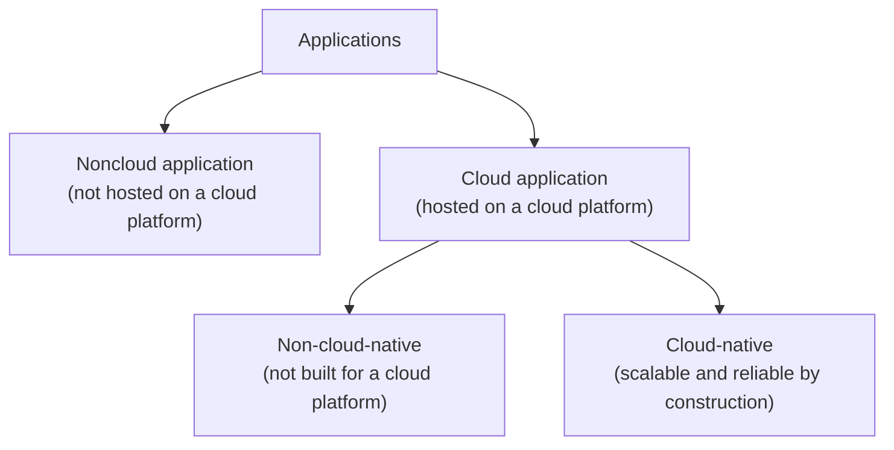

# 12. Cloud and services

[← 11. Durable executions](11-durable-executions.md) · [Book](../README.md)

## Summary

Cloud, cloud-native, serverless and microservices are everywhere, yet their meanings are vague. This "paradox of popularity" motivates the final chapter, which offers the author's accurate, concise definitions. They are consistent with industry understanding but not industry standards (p. 156).

The chapter starts from the shift the author lived through at SAP between 2008 and 2018, from ticket-driven VMs to on-demand machines. That turned systems from **proactive and static** into **reactive and dynamic**, and made **elasticity** possible (p. 157). It then builds the definitions:

- **Cloud computing** separates resource consumers from resource providers that let them acquire and release resources on demand (pp. 157–158).
- **Cloud-native** means scalable and reliable *by construction*, not merely hosted in the cloud (pp. 158–159).
- **Serverless** means resources are acquired *after* an event arrives, with **cold and hot paths** (pp. 159–161).
- **A service** is a *contract* between a component and the rest of the system, not the set of components implementing it. A movie-recommendation service grows from one process into a dynamic web of processes, load balancers and autoscalers while its contract stays constant (pp. 161–166).

The book closes with a band whose musicians read the same sheet differently, and an appeal to maximize the overlap between our mental models and reality (p. 166).

## Key takeaways

- **Elasticity** is achieving scalability and reliability by acquiring and releasing resources on demand (Figure 12.1). It replaced long-lived, well-known resources with short-lived ones, and a static topology with a dynamic, self-regulating one (p. 157).
- **Cloud computing** = resource consumers + resource providers + on-demand acquire and release. Platforms are public (AWS, Google Cloud, Azure) or private (company-run OpenStack, Cloud Foundry, Kubernetes) (pp. 157–158).
- **A cloud application** is any application hosted on a cloud platform. **A cloud-native application** is scalable and reliable *by construction*, using the cloud's acquire and release; the qualities are *assured*, not merely requested (p. 158).
- **Platform building blocks:** a **supervisor** replaces failed resources, a **scaler** matches resources to demand and a **load balancer** distributes requests. In Kubernetes these are a Deployment, a HorizontalPodAutoscaler and a Service (pp. 158–159).
- **Lift and shift** brings limited benefits. A vanilla WordPress install in the cloud isn't cloud-native, because it has no load or failure detection and mitigation. Containers and microservices are technology and architecture choices, not the definition (p. 159).
- **Traditional:** acquire → receive → process → release. **Serverless:** receive → acquire → process → release, so the system must work out the resources it needs *from the event itself* (pp. 160–161).
- **Cold path:** acquisition happens between receiving and processing. **Hot path:** resources are already held from earlier events (p. 161).
- **A service is a contract, not components.** From a component's local view there's only itself and "the rest of the system". The recommendation service's implementation keeps changing; its contract, Get: ID → [ID], is the only constant (pp. 162–166).

## Section outline

*From the book’s own table of contents (PDF bookmarks); printed page numbers.*

- 12.1 From proactive to reactive — p. 157
- 12.2 Cloud computing — p. 157
- 12.3 Cloud-native computing — p. 158
- 12.4 Serverless computing — p. 159
  - 12.4.1 Traditional — p. 160
  - 12.4.2 Serverless — p. 160
  - 12.4.3 Cold path vs. hot path — p. 161
- 12.5 Service — p. 161
  - 12.5.1 Global view vs. local view — p. 162
  - 12.5.2 Example recommendation service — p. 163
- 12.6 Final thoughts — p. 166

## Notes

### 12.1 From proactive to reactive

At SAP in 2008, getting one virtual machine meant a support ticket, management approval and a wait for provisioning, followed by months of configuration and maintenance. By the time the author left a decade later, sets of VMs appeared and disappeared on demand, limited only by budget (p. 157).

| | Before the cloud | With the cloud (p. 157) |
|---|---|---|
| Resources | Few, **long-lived**, well-known, with stable identities and network addresses | Many, **short-lived**, with short-lived properties, especially network addresses |
| Engineering stance | **Predict** load and failure and address them **proactively** | **Observe** load and failure and address them **reactively**: systems self-regulate |
| Topology | Static | Dynamic |

**Elasticity** is the ability to achieve scalability and reliability by acquiring and releasing resources on demand (Figure 12.1) (p. 157).

### 12.2 Cloud computing

Cloud computing separates the world into **resource consumers** and **resource providers**. A consumer acquires and releases virtually unlimited resources, such as compute (VMs) or storage (disks), on demand from a **cloud platform** (p. 157).

| Platform | Offers resources… | Examples (p. 158) |
|---|---|---|
| **Public** | Outside its own organization | AWS, Google Cloud Platform, Microsoft Azure |
| **Private** | Only inside its own organization | Company-run OpenStack, Cloud Foundry and Kubernetes instances |

These two aspects, the consumer/provider split and on-demand acquire and release, are the **core primitives** from which the chapter defines cloud-native and serverless (p. 158).

### 12.3 Cloud-native computing

*After Figures 12.2–12.3.* *By construction* contrasts with *by requirement*: the design and implementation guarantee scalability and reliability, rather than merely desiring them (p. 158).

| Building block | Role | Kubernetes example (pp. 158–159) |
|---|---|---|
| **Supervisor** | Monitors resources; acquires a replacement when one is believed to have failed | Deployment |
| **Scaler** | Acquires or releases resources to match demand | HorizontalPodAutoscaler |
| **Load balancer** | Distributes requests across available resources | Service |

These tools don't make an application cloud-native by themselves. Scalability and reliability need a holistic design at the platform *and* the application level: failure tolerance, partitioning and redundancy, as in the rest of the book (p. 159). Two aha! moments (p. 159):

- **Lift and shift**, moving an existing application to the cloud with few or no changes, gains little. Elasticity has to be designed in.
- **Cloud-native "technologies".** Common definitions stress containers, microservices and dynamic orchestration, plus *declarative* and *immutable*. Containers are a technical choice and microservices an architectural one; picking others doesn't stop an application from being scalable and reliable by construction.

### 12.4 Serverless computing

The minimal model (Figure 12.4): a system has **resources** (compute, network, storage) and handles **events** (requests). It must be able to acquire resources, release resources, receive events and process events. The universal constraint: an event can't be processed before its resources are acquired (pp. 159–160).

| Environment | Order of actions | Acquisition is… (pp. 160–161) |
|---|---|---|
| **Traditional** (Figure 12.5) | Acquire → receive → process → release | **Proactive**: done a priori by the operator |
| **Serverless** (Figure 12.6) | Receive → acquire → process → release | **Reactive**: done on demand, so the system must determine the needed resources *from the event itself* |

#### 12.4.3 Cold path vs. hot path (p. 161)

Real serverless platforms don't release resources immediately. They keep them for a while in anticipation of more events:

| Path | Sequence (Figure 12.7) |
|---|---|
| **Cold** | Receive → **acquire** → process: acquisition sits between receiving and processing |
| **Hot** | Receive → process: resources are already held |

> **Try it:** [Cold path, hot path](../widgets/12-serverless-paths.html) — send bursts of events to a traditional (pre-provisioned) system and to a serverless one, change how long the serverless platform keeps resources after an event, and trade cold-path latency against resources held idle.

### 12.5 Service

"Microservices" invites endless debate. To clarify what constitutes one rather than critique it, the author uses the less charged word **service** (p. 161).

The familiar whiteboard ritual: rectangles for services and lines for interactions. Then the rectangles get duplicated, and load balancers, autoscalers, databases, queues and timers appear. Where are the boundaries now? Is each rectangle an autonomous service, or do rectangles that share a label form one? Are databases inside or outside the boundary? (pp. 161–162)

#### 12.5.1 Global view vs. local view (p. 162)

- An all-knowing observer sees C1, C2 and the network (Figure 12.8).
- C1 sees only "me … and the rest of the system" (Figure 12.9).
- From C1's local view, a service isn't a component or a set of components. It's a **contract** specifying the interaction between C1 and the rest of the system.

The echo service: POST to `http://echo.io` and get your request body back. The component isn't addressing a machine at echo.io; it's invoking a **systemwide contract**. This is a logical view rather than a physical one (p. 162).

#### 12.5.2 Example recommendation service (pp. 163–166)

The contract is **Get: ID → [ID]**: given a movie id, return a list of movie ids. The implementation evolves:

| Step | Implementation | Problem it solves |
|---|---|---|
| Figure 12.10 | One Python process querying a database | Functionally correct, but neither scalable nor reliable |
| Figure 12.11 | Duplicated processes (redundancy) | A single process's limits |
| Figure 12.12 | A **primary** group (real recommendations from the database) and a **backup** group (static "fake" recommendations from an always-available local file) | The database being overloaded or down |
| Figure 12.13 | A **smart load balancer** that defaults to primary and retries on backup after an error, plus an **autoscaler** per group | Unequal groups; load and failure within groups |
| Figure 12.14 | Redundant load balancers and autoscalers | Those components' own load and failures |
| Figure 12.15 | Autoscalers shared across groups, even across service boundaries | Correcting the false 1:1 picture |

The final implementation is a dynamic, ever-changing set of components, some dedicated to this service and some shared. **The contract is the only constant.** A consumer ignores all of this and asks "the rest of the system" for recommendations (p. 166).

*The vault's summary of Figures 12.13–12.15.*

### 12.6 Final thoughts

A band whose musicians read the same note as a C and as an F produces dissonance. Shallow, misaligned understanding of terms such as cloud, serverless and microservices does the same to engineers. Figure 12.16 draws Reality, My Mental Model and Your Mental Model as overlapping circles, and **thinking in distributed systems aims to maximize their intersection**. The book ends by urging readers to keep digging into the core of every concept (p. 166).

## Trade-offs at a glance

| Choice | Buys | Costs |
|---|---|---|
| Traditional (proactive) provisioning | No acquisition latency on the request path | Paying for idle capacity; must predict load |
| Serverless (reactive) | Pay per use; no capacity planning | Cold-path latency; the system must infer resources from the event |
| Long keep-alive after an event | More hot paths | Idle resources held |
| Lift and shift | A fast migration | Little elasticity |
| Cloud-native by construction | Scalability and reliability assured | Detection and mitigation must be designed into the application |
| Primary + static backup | Always answers | Degraded ("fake") answers when the database fails |
| Service as a contract | Freedom to change the implementation | Boundaries are logical, not visible in the topology |

## Beyond the book

- **Graceful degradation.** The recommendation service's backup group is a *fallback*. Netflix popularized this for recommendations, alongside circuit breakers (stop calling a failing dependency for a while) and bulkheads (isolate resources per dependency). In Chapter 3's terms, the backup is nonmasking: still live, but with weaker answers.
- **Cold-start mitigation.** Real platforms reduce cold paths with provisioned or minimum instances (traditional acquisition again, for a baseline), snapshotting initialized runtimes, and lighter isolation (lightweight VMs, V8 isolates). Each moves some acquisition back before the event.
- **Contracts in practice.** If a service is its contract, the contract deserves versioning and compatibility rules. [DDIA Ch. 5](../../designing-data-intensive-applications/chapters/05-encoding-and-evolution.md) covers schema evolution for the data that services exchange.

## Connections

- **Related chapters:** [1. Thinking in distributed systems](01-thinking-in-distributed-systems-models-mindsets-and-mechanics.md) (global vs. local view, responsiveness), [3. Failure tolerance](03-failure-tolerance.md) (supervision, retries and escalation), [7. Partitioning](07-partitioning.md) and [8. Replication](08-replication.md) (what "by construction" requires), [11. Durable executions](11-durable-executions.md) (processes that survive their short-lived resources).

## Check yourself

*Questions and answers are the vault's, written from the notes above; answers cite the book's pages.*

1. **What is elasticity in the book's terms?**

   *Answer:* The ability to achieve scalability and reliability by acquiring and releasing resources on demand to meet demand (p. 157).

2. **Why isn't a vanilla WordPress install on a cloud platform cloud-native?**

   *Answer:* It's a cloud application, but it isn't scalable and reliable by construction: it lacks load and failure detection and mitigation (pp. 158–159).

3. **Name the three platform building blocks and their Kubernetes counterparts.**

   *Answer:* Supervisor (Deployment), scaler (HorizontalPodAutoscaler), load balancer (Service) (pp. 158–159).

4. **What distinguishes serverless from traditional computing in the minimal model?**
   - [ ] Serverless has no servers
   - [x] Resources are acquired after the event is received, not before
   - [ ] Events are processed without resources

   *Answer:* Serverless acquires resources reactively, so the system must determine them from the event (pp. 160–161).

5. **What is a hot path?**

   *Answer:* Receiving and processing an event without acquiring resources in between, because resources from earlier events are still held (p. 161).

6. **From a component's local view, what is a service?**

   *Answer:* A contract specifying its interaction with the rest of the system, not the set of components that implement it (p. 162).

7. **How does the recommendation service stay available when its database fails?**

   *Answer:* A smart load balancer retries failed requests on a backup group that serves static recommendations from a local file (pp. 163–164).
