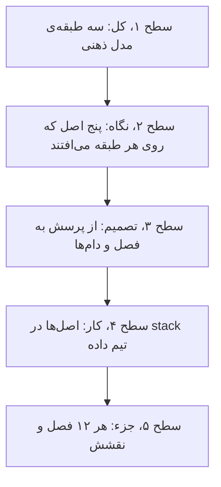
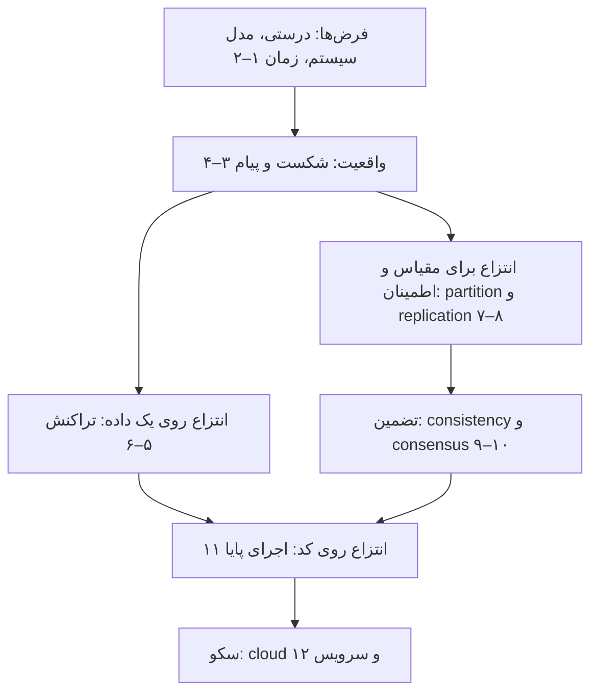
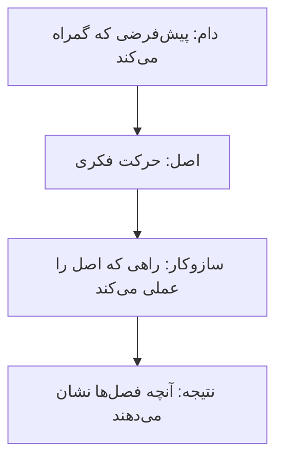
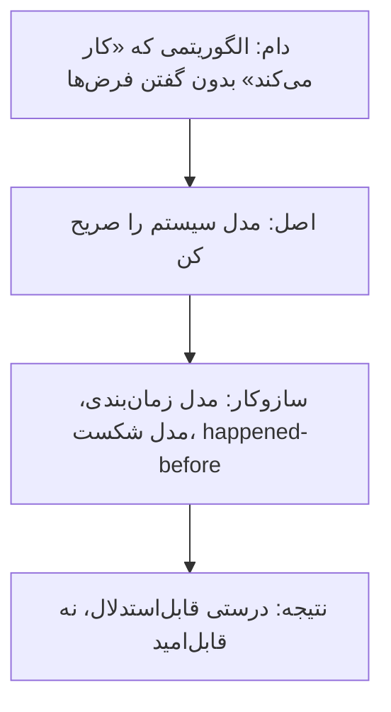
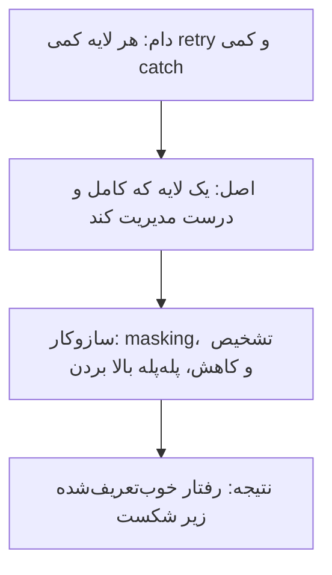
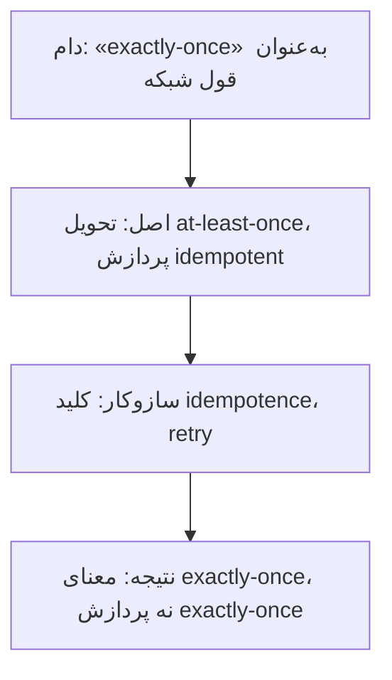
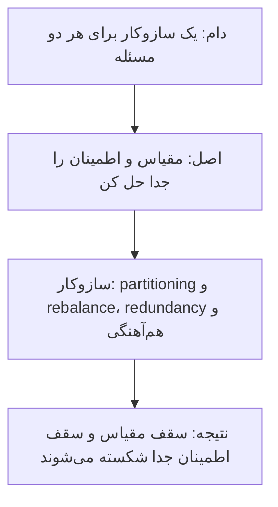
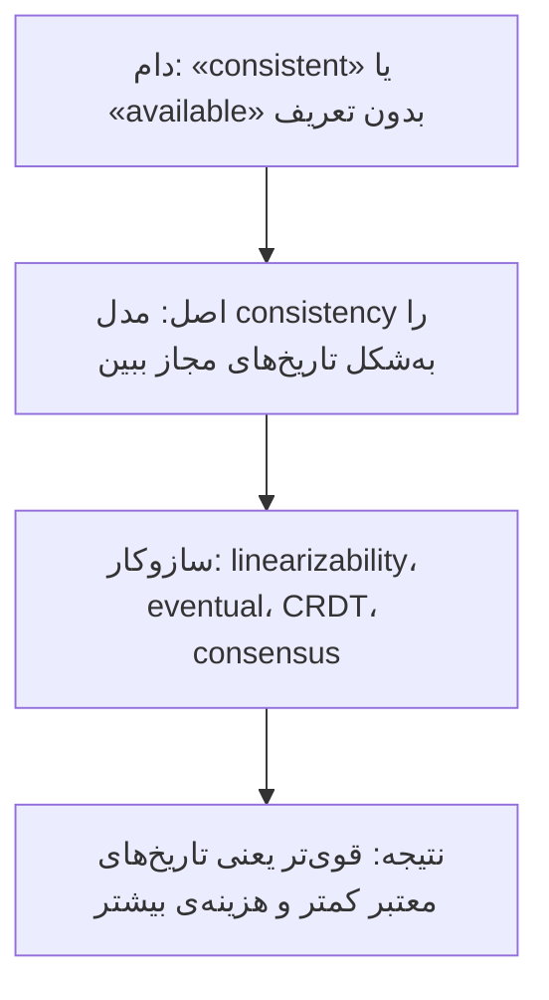

# چارچوب کتاب: مدل ذهنی سیستم توزیع‌شده

[کتاب](README.md) · [فصل ۱ ←](chapters/01-thinking-in-distributed-systems-models-mindsets-and-mechanics.md)

این صفحه **سنتز خود vault** است، نه بخشی از کتاب. کتاب به‌جای فناوری‌ها مدل ذهنی یاد می‌دهد؛ این‌جا همان مدل‌ها در یک ساختار کنار هم می‌نشینند تا ببینید هر فصل کدام قطعه از مدل را می‌سازد و فصل‌ها چطور روی هم بنا می‌شوند.

چارچوب سه لایه دارد. **نقشه‌ی کتاب** می‌گوید مدل از چه قطعه‌هایی ساخته می‌شود: از فرض‌ها، به شکست و پیام، به انتزاع‌هایی که شکست را پنهان می‌کنند. **پنج اصل** می‌گوید با چه نگاهی هر قطعه را بخوانید. **راهنمای تصمیم و stack** می‌گوید برای هر پرسش کدام فصل را باز کنید و هر اصل در stack تیم داده کجا می‌نشیند. همه‌ی ادعاها به فصل‌ها ارجاع می‌دهند؛ نام‌گذاری اصل‌ها مال vault است.

## تصویر کل

### کل کتاب در سه جمله

خوانش vault از کتاب، پیش از هر جزئی:

1. **هر برنامه‌ی امروزی توزیع‌شده است و هر الگوریتم فقط نسبت به یک مدل سیستم درست است.** پیش از هر سازوکاری فرض‌ها را صریح کنید ([۱](chapters/01-thinking-in-distributed-systems-models-mindsets-and-mechanics.md)، [۲](chapters/02-system-models-order-and-time.md)).
2. **شکست و عدم قطعیت پیام ذاتی‌اند؛ کار ما مدیریت آن‌هاست، نه حذفشان.** تحویل با پردازش فرق دارد و exactly-once فقط یک «گویی» است ([۳](chapters/03-failure-tolerance.md)، [۴](chapters/04-message-delivery-and-processing.md)).
3. **انتزاع خوب شکست را پنهان می‌کند تا بشود وانمود کرد نیست.** تراکنش، replication، consensus و اجرای پایا همه همین کار را در لایه‌های مختلف می‌کنند ([۵](chapters/05-transactions.md)، [۸](chapters/08-replication.md)، [۱۰](chapters/10-distributed-consensus.md)، [۱۱](chapters/11-durable-executions.md)).

### از کل به جزء

## نقشه‌ی کتاب

### سه طبقه

*سطح ۱ از ۵: کل.*

مدل ذهنی کتاب سه طبقه دارد. طبقه‌ی پایین فرض‌هاست: درستی، مدل سیستم، ترتیب و زمان. طبقه‌ی میانی واقعیت‌هایی است که هر سیستمی با آن‌ها روبه‌روست: شکست و پیامی که شاید رسیده باشد. طبقه‌ی بالا انتزاع‌هایی است که این واقعیت‌ها را پنهان می‌کنند، و در آخر cloud همه را به سرویس می‌برد.

### طبقه‌ها و پرسش‌هایشان

| طبقه | پرسش اصلی | مفهوم‌های کلیدی | بده‌بستان اصلی | فصل‌ها |
|---|---|---|---|---|
| فرض‌ها | «درست» یعنی چه و در چه دنیایی؟ | ایمنی و liveness، مدل زمان‌بندی، مدل شکست، happened-before | فرض قوی‌تر در برابر واقع‌بینی | [۱](chapters/01-thinking-in-distributed-systems-models-mindsets-and-mechanics.md)، [۲](chapters/02-system-models-order-and-time.md) |
| واقعیت | با شکست و پیام نامطمئن چه کنیم؟ | masking، تشخیص و کاهش، idempotence، کلید idempotence | تکرار در برابر گم شدن | [۳](chapters/03-failure-tolerance.md)، [۴](chapters/04-message-delivery-and-processing.md) |
| تراکنش | چطور وانمود کنیم concurrency و شکست نیست؟ | serializability، undo، 2PC، resource manager | تضمین در برابر بند آمدن | [۵](chapters/05-transactions.md)، [۶](chapters/06-distributed-transactions.md) |
| مقیاس و اطمینان | چطور از سقف یک مؤلفه رد شویم؟ | partitioning، rebalance، redundancy، leader و follower | جابه‌جایی داده در برابر توازن | [۷](chapters/07-partitioning.md)، [۸](chapters/08-replication.md) |
| تضمین | کپی‌ها چه قولی می‌دهند و چطور توافق می‌کنند؟ | linearizability، eventual consistency، CRDT، quorum، term | تازگی در برابر availability | [۹](chapters/09-consistency.md)، [۱۰](chapters/10-distributed-consensus.md) |
| کد پایا | تابعی که وسطش می‌شکند چه می‌شود؟ | اجرای جزئی، بازیابی failure-transparent، Saga | سادگی کد در برابر هزینه‌ی ثبت | [۱۱](chapters/11-durable-executions.md) |
| سکو | cloud و سرویس دقیقاً یعنی چه؟ | کشسانی، سرویس به‌عنوان قرارداد، مسیر سرد | هزینه در برابر latency | [۱۲](chapters/12-cloud-and-services.md) |

## پنج اصل

*سطح ۲ از ۵: نگاه.*

پنج حرکت فکری در سراسر کتاب تکرار می‌شوند. هر اصل با یک زنجیره‌ی چهارتایی شروع می‌شود: **دام** رایج، **اصلی** که آن را می‌بندد، **سازوکاری** که اصل را عملی می‌کند و **نتیجه**.

### اصل ۱: اول مدل، بعد الگوریتم

- **دانستن همان فهمیدن نیست**؛ مدل ذهنی خوب درست و کامل است ([۱](chapters/01-thinking-in-distributed-systems-models-mindsets-and-mechanics.md)).
- **مدل سیستم همان قاعده‌های بازی است**، و سیستم‌های واقعی partially synchronous‌اند ([۲](chapters/02-system-models-order-and-time.md)).
- **درستی برابر ایمنی و liveness است** ([۱](chapters/01-thinking-in-distributed-systems-models-mindsets-and-mechanics.md))، و همین دو در consensus برمی‌گردند ([۱۰](chapters/10-distributed-consensus.md)).

### اصل ۲: شکست را در پایین‌ترین لایه‌ی کامل مدیریت کن

- **شکست را در پایین‌ترین لایه‌ای مدیریت کنید که می‌تواند درست و کامل مدیریتش کند** ([۳](chapters/03-failure-tolerance.md)).
- **شاهد یک crash یک timeout است**، و تشخیص ایمنی را تضمین می‌کند و کاهش liveness را ([۳](chapters/03-failure-tolerance.md)).
- **شکست RM روش 2PC را بند نمی‌آورد ولی شکست TC می‌تواند** ([۶](chapters/06-distributed-transactions.md)).

### اصل ۳: تحویل را از پردازش جدا کن

- **تحویل با پردازش فرق دارد** و TCP نجاتتان نمی‌دهد ([۴](chapters/04-message-delivery-and-processing.md)).
- **بی‌پاسخ دو انتخاب هست**: دوباره بفرستید و تکرار را بپذیرید، یا نفرستید و گم شدن را ([۴](chapters/04-message-delivery-and-processing.md)).
- **ویژگی idempotence با کلید idempotence** retry را امن می‌کند ([۴](chapters/04-message-delivery-and-processing.md))، و اجرای پایا همین را به کل تابع می‌برد ([۱۱](chapters/11-durable-executions.md)).

### اصل ۴: partition برای مقیاس، replication برای اطمینان

- **پارتیشن‌بندی از سقف مقیاس‌پذیری یک مؤلفه رد می‌شود** و با متوازن کردن فرق دارد ([۷](chapters/07-partitioning.md)).
- **مفهوم redundancy برابر replication به‌علاوه‌ی هم‌آهنگی است** و برای قابلیت اطمینان است ([۸](chapters/08-replication.md)).
- **مفهوم latency replication ذاتی است** ([۸](chapters/08-replication.md))، پس هر خواندن از follower قولی درباره‌ی تازگی می‌خواهد ([۹](chapters/09-consistency.md)).

### اصل ۵: تضمین مجموعه‌ای از تاریخ‌های مجاز است

- **مفهوم consistency model مجموعه‌ای از تاریخ‌هاست** و قوی‌تر یعنی تاریخ‌های معتبر کمتر ([۹](chapters/09-consistency.md)).
- **قاعده‌ی CAP «دو تا را بردار» نیست** ([۹](chapters/09-consistency.md)).
- **همه‌ی termها هم ساعت منطقی‌اند و هم fencing token** ([۱۰](chapters/10-distributed-consensus.md)).

## از پرسش به فصل

*سطح ۳ از ۵: تصمیم.*

| پرسش | اول بخوانید | بعد |
|---|---|---|
| این الگوریتم در چه شرایطی درست است؟ | [۲](chapters/02-system-models-order-and-time.md) | [۱](chapters/01-thinking-in-distributed-systems-models-mindsets-and-mechanics.md) |
| سرویس پاسخ نداد؛ دوباره بفرستم؟ | [۴](chapters/04-message-delivery-and-processing.md) | [۳](chapters/03-failure-tolerance.md) |
| retry ردیف تکراری ساخته | [۴](chapters/04-message-delivery-and-processing.md) | [۱۱](chapters/11-durable-executions.md) |
| نوشتن روی دو سیستم باید با هم باشد | [۶](chapters/06-distributed-transactions.md) | [۱۱](chapters/11-durable-executions.md) |
| داده برای یک ماشین زیاد است | [۷](chapters/07-partitioning.md) | [۸](chapters/08-replication.md) |
| خواندن از replica داده‌ی کهنه می‌دهد | [۹](chapters/09-consistency.md) | [۸](chapters/08-replication.md) |
| دو leader هم‌زمان | [۱۰](chapters/10-distributed-consensus.md) | [۳](chapters/03-failure-tolerance.md) |
| کار چندمرحله‌ای وسطش می‌شکند | [۱۱](chapters/11-durable-executions.md) | [۵](chapters/05-transactions.md) |
| serverless یا سرویس همیشه‌روشن؟ | [۱۲](chapters/12-cloud-and-services.md) | [۷](chapters/07-partitioning.md) |

## دام‌ها

1. **ساعت دیواری را ترتیب درست دانستن** ([۲](chapters/02-system-models-order-and-time.md)).
2. **واژه‌ی asynchronous بدون تعریف** ([۲](chapters/02-system-models-order-and-time.md)).
3. **پراکندن retry در همه‌ی لایه‌ها** ([۳](chapters/03-failure-tolerance.md)).
4. **باور به exactly-once در شبکه** ([۴](chapters/04-message-delivery-and-processing.md)).
5. **فرض این‌که consistency در ACID همان consistency توزیع‌شده است** ([۵](chapters/05-transactions.md)، [۹](chapters/09-consistency.md)).
6. **تصمیم به abort با timeout در 2PC**، که ناایمن است ([۶](chapters/06-distributed-transactions.md)).
7. **یکی دانستن partitioning و balancing** ([۷](chapters/07-partitioning.md)).
8. **فرض «نوشتن روی leader و خواندن از follower» بدون هزینه** ([۸](chapters/08-replication.md)).
9. **خواندن CAP به‌شکل «دو تا را بردار»** ([۹](chapters/09-consistency.md)).
10. **ترکیب کردن اتمی بودن چند تابع** و انتظار اتمی بودن کل ([۱۱](chapters/11-durable-executions.md)).

## در stack شما

*سطح ۴ از ۵: کار.*

هر اصل در [stack مرجع](../../practice/reference-stack.md) یک جای مشخص دارد. کادرهای *In practice* هر فصل جزئیاتش را می‌دهند.

| بخش stack | اصل | فصل‌ها | یادآوری |
|---|---|---|---|
| retry در Airflow و Kubernetes Job | ۲، ۳ | [۳](chapters/03-failure-tolerance.md)، [۴](chapters/04-message-delivery-and-processing.md) | retry فقط با نوشتن idempotent امن است |
| loader با cursor روی `update_date` | ۳ | [۴](chapters/04-message-delivery-and-processing.md) | cursor کلید idempotence طبیعی است؛ اجرای دوباره همان پنجره را می‌خواند |
| دو replica در ClickHouse | ۴، ۵ | [۸](chapters/08-replication.md)، [۹](chapters/09-consistency.md) | replication asynchronous یعنی eventual consistency بین replicaها |
| Keeper و etcd | ۵ | [۱۰](chapters/10-distributed-consensus.md) | هر دو consensus با term و quorum‌اند |
| DAGهای چندمرحله‌ای | ۲، ۳ | [۱۱](chapters/11-durable-executions.md) | هر task را جدا قابل‌تکرار کنید، مثل یک اجرای پایای دستی |
| Argo CD و GitOps | ۱ | [۱۲](chapters/12-cloud-and-services.md) | حالت مطلوب در Git، reconciliation به‌سمت آن |
| prediction API | ۳ | [۴](chapters/04-message-delivery-and-processing.md)، [۱۲](chapters/12-cloud-and-services.md) | سرویس قرارداد است؛ retry کلاینت را در طراحی بپذیرید |

> **In practice:** اصل‌های «تحویل جدا از پردازش» و «شکست در پایین‌ترین لایه‌ی کامل» در یک DAG چندمرحله‌ای به هم می‌رسند.
>
> **Your turn:** یک DAG سه task دارد: بارگذاری، ساختن Silver و ساختن Gold. task دوم بعد از نوشتن نصف partitionها می‌افتد و Airflow کل DAG را از اول اجرا می‌کند. چه چیزی ممکن است خراب شود و کجا درستش می‌کنید؟
>
> *Answer:* بارگذاری ممکن است داده را دوباره بیاورد و Silver ردیف تکراری بگیرد، چون تحویل دوباره بدون پردازش idempotent یعنی تکرار ([۴](chapters/04-message-delivery-and-processing.md)). درمان در خود هر task است، پایین‌ترین لایه‌ای که کامل مدیریت می‌کند: هر task partition خودش را بازنویسی کند و retry فقط task شکسته را اجرا کند ([۳](chapters/03-failure-tolerance.md)، [۱۱](chapters/11-durable-executions.md)).

## نقشه‌ی فصل‌ها

*سطح ۵ از ۵: جزء.*

| فصل | طبقه | اصل | نقش در چارچوب |
|---|---|---|---|
| [۱](chapters/01-thinking-in-distributed-systems-models-mindsets-and-mechanics.md) | فرض‌ها | ۱ | مدل ذهنی، درستی به‌شکل ایمنی و liveness |
| [۲](chapters/02-system-models-order-and-time.md) | فرض‌ها | ۱ | مدل سیستم، مدل شکست، ترتیب و زمان |
| [۳](chapters/03-failure-tolerance.md) | واقعیت | ۲ | تحمل شکست: masking، تشخیص و کاهش |
| [۴](chapters/04-message-delivery-and-processing.md) | واقعیت | ۳ | تحویل و پردازش پیام، idempotence |
| [۵](chapters/05-transactions.md) | تراکنش | ۲ | تراکنش به‌شکل درستی و کامل بودن |
| [۶](chapters/06-distributed-transactions.md) | تراکنش | ۲ | روش 2PC و resource manager |
| [۷](chapters/07-partitioning.md) | مقیاس و اطمینان | ۴ | پارتیشن‌بندی و rebalance |
| [۸](chapters/08-replication.md) | مقیاس و اطمینان | ۴ | مفهوم redundancy و replication |
| [۹](chapters/09-consistency.md) | تضمین | ۵ | مدل‌های consistency و CAP |
| [۱۰](chapters/10-distributed-consensus.md) | تضمین | ۱، ۵ | مفهوم consensus، Raft و quorum |
| [۱۱](chapters/11-durable-executions.md) | کد پایا | ۲، ۳ | اجرای پایا و Saga |
| [۱۲](chapters/12-cloud-and-services.md) | سکو | ۱ | مفهوم cloud، serverless و سرویس |
