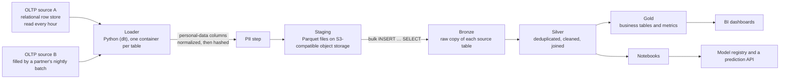
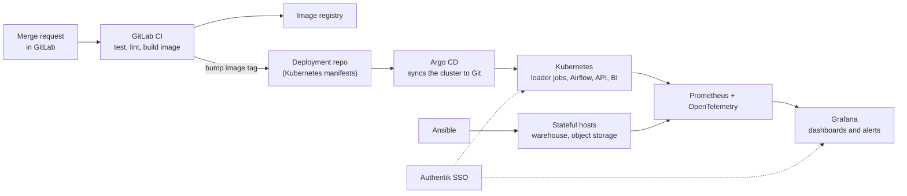

# The reference stack

The vault's *In practice* callouts tie each book's ideas to one concrete, ordinary data platform: the kind a small data team runs for a product that moves money. It is a composite. It describes no particular company, and it names no internal systems, tables or figures. Every callout and *Your turn* question is written against this page, so update it here (and only here) when the stack changes.

## The path of the data

*The vault's own diagram of the reference stack.*

*The vault's own diagram of how changes reach production and how the platform is watched.*

| Part | What it is | What matters for the books |
|---|---|---|
| **Sources** | Two relational OLTP databases the team reads but does not own. One is a read-only replica of the product's main database (users, loans, payments); the other receives accounts and transactions in one nightly batch from a partner. | Normalized schemas, many small linked tables, IDs everywhere. The team cannot change them. |
| **Ingestion** | A loader built on dlt. Each table is declared in one YAML file: columns to include, a schedule, retries, `write_disposition: append`, and an **incremental cursor** on an `update_date` column. Orchestrated by Airflow, one DAG per table. | ELT, not ETL. The loader sees only rows whose `update_date` moved, so **hard deletes in the source are invisible** to it. |
| **Personal data** | Phone numbers, national IDs and card numbers are normalized to one canonical spelling, then hashed with a salted SHA-256 before anything is stored. Masking is used where people must recognise a value but never join on it. | Hashes are stable join keys only because of the normalization step. |
| **Staging** | Parquet files on S3-compatible object storage, kept only until the table's next load. | Not a lake: a short stop that makes bulk loads safer. |
| **Warehouse** | ClickHouse: column-oriented, MergeTree tables partitioned by month with a sparse primary index on `ORDER BY`, two replicas. Everyone queries it through a SQL proxy that applies per-person logins and limits. | OLAP, not OLTP. Reads only the columns a query names; joins and updates are possible but cost more than in a row store. |
| **Layers (medallion)** | **Bronze**: one row per landed source row, same tables and columns as the source. **Silver**: one row per real event (newest version of each row), sources joined on shared keys. **Gold**: one row per business question (by month, segment, customer). | Bronze keeps raw history, so any Silver or Gold table can be rebuilt by rerunning SQL. |
| **Transformation** | SQL inside the warehouse, started by Airflow; dbt under evaluation. | Declarative SQL; models are `SELECT`s. |
| **Serving** | A BI tool (Metabase) with dashboards versioned in Git; per-person notebooks (JupyterHub); a model registry (MLflow) and a small HTTP prediction API, e.g. classifying a transaction's merchant text into a spending category. | Analysts wrangle DataFrames; apps call a narrow API, never raw SQL. |
| **Around it** | Dev, production and analytical zones kept apart; every change goes through Git and CI; data-quality checks (freshness, volume, uniqueness, reconciliation with the source, schema drift, leaked personal data) are planned as gates between layers. | Governance is a design constraint, not an afterthought. |
| **Runtime** | Every service is a Docker image: loader jobs, Airflow, the prediction API, Metabase, JupyterHub. Stateless services run on Kubernetes (Deployments, CronJobs, Jobs for one-off backfills); smaller hosts run Docker Compose. Stateful hosts (the warehouse, object storage) are provisioned with Ansible. | A job is a pod that can be killed and rescheduled at any time: retries, idempotent writes and checkpoints are not optional. |
| **Delivery** | GitLab CI runs tests, linting and SQL checks on every merge request, builds and pushes images, and bumps an image tag in a deployment repository. Argo CD watches that repository and syncs the cluster to it (GitOps); rollback is a Git revert. Secrets live outside Git and are injected at deploy time. | The Git history *is* the deployment history: what runs is what the repository says, so drift is visible and reversible. |
| **Observability** | Prometheus scrapes metrics from services, Kubernetes and the warehouse; Grafana shows dashboards and fires alerts; OpenTelemetry instruments the loader and the API (traces, metrics, logs with one trace ID). Pipeline health (row counts, lag, freshness, failed runs) is exported as metrics next to system health. | Data incidents and system incidents are read on the same screen; an alert should point at a run, a table and a trace. |
| **Identity** | Authentik is the single sign-on provider (OIDC/SAML) in front of the human-facing tools: Metabase, JupyterHub, Airflow, Grafana, Argo CD, GitLab. Groups in Authentik map to roles in each tool; service accounts are separate from people. | Who can see which layer is decided in one place; offboarding is one switch. |

## Typical entities

Customers, accounts, cards, transactions (postings), loans and loan requests, transfers between accounts, merchants and spending categories. Customers and accounts are many-to-many (joint accounts, business accounts with several signatories); cards and transactions each belong to one account.

## How the team works

The management and leadership books are tied to the same composite team, not to the platform's machines.

| Part | What it is | What matters for the books |
|---|---|---|
| **People** | A small data team inside a product company: a lead, a few data and analytics engineers, analysts, one platform-minded engineer who owns the runtime. Stakeholders are product, finance and risk teams who consume dashboards and models. | Most work is requested by other teams; priorities compete, and "data is wrong" arrives as an interrupt. |
| **Flow of work** | Issues and merge requests in GitLab; every change is reviewed; small batches merged often; a short planning rhythm with a visible board. | Review, small changes and CI are the team's main quality and knowledge-sharing tools. |
| **Running it** | An on-call rota answers Grafana alerts for failed or late pipelines and stale dashboards; incidents get a blameless written review with follow-up issues. | Operational load is visible in alerts and incident reviews, so it can be measured and planned for. |
| **Measuring it** | Delivery is read from GitLab (lead time of merge requests, deploy frequency through Argo CD, change failure rate from rollbacks) and from data health (freshness, failed runs, data incidents). | Numbers describe the system of work, never individual performance. |
